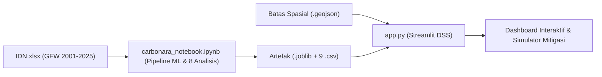

# Carbonara — Indonesia Forest Carbon DSS

Prototipe sistem analitik, pemodelan emisi, dan simulasi mitigasi karbon kehutanan Indonesia pada tingkat **Nasional**, **Provinsi**, hingga **Kabupaten/Kota** berbasis data panel Global Forest Watch (`2001–2025`).

Aplikasi web dibangun menggunakan **Streamlit** ([`app.py`](app.py)) dan didukung oleh *offline pipeline* berbasis `HistGradientBoostingRegressor` ([`carbonara_notebook.ipynb`](carbonara_notebook.ipynb)) untuk pemantauan dinamika deforestasi, proyeksi emisi `2026–2030`, dan evaluasi target **Indonesia's FOLU Net Sink 2030**.



---

## Daftar Isi

- [Fitur Utama](#fitur-utama)
- [Instalasi dan Menjalankan Secara Lokal](#instalasi-dan-menjalankan-secara-lokal)
- [Reproduksi Pipeline Pelatihan](#reproduksi-pipeline-pelatihan)
- [Dokumentasi Teknis](#dokumentasi-teknis)
- [Struktur Direktori](#struktur-direktori)

---

## Fitur Utama

1. **Tren Historis & Dinamika Pemicu:** Evolusi emisi kotor tahunan (`2001–2025`), dekomposisi 7 kategori pemicu kehilangan tutupan pohon, proporsi hutan primer vs non-primer, serta rekomendasi kebijakan otomatis.
2. **Peta Kloropet & Prioritas Wilayah:** Pemetaan spasial tingkat provinsi dan kabupaten/kota dengan filter jendela waktu (`1–25` tahun), peringkat Top-N wilayah, serta kurva konsentrasi Pareto (`86` dari `497` kabupaten menyumbang `80%` emisi nasional).
3. **Neraca Emisi Bersih (*Net Flux*) & *Hotspot* Gambut:** Evaluasi posisi *Net Sink* (`308` kabupaten) vs *Net Source* (`189` kabupaten) serta identifikasi wilayah dengan rasio pelepasan karbon melampaui biomassa atas tanah (*peatland proxy*).
4. **Tipologi Wilayah Kabupaten:** Pengelompokan 497 kabupaten/kota ke dalam 5 klaster tipologi biofisik dan pemicu melalui PCA 2D dan *K-Means*.
5. **Proyeksi Emisi `2026–2030`:** Peramalan multi-horizon tervalidasi *rolling-origin backtest* beserta pita ketidakpastian 80% (`P10–P90`).
6. **Deteksi Anomali Karhutla (Nasional):** Identifikasi 20 lonjakan emisi ekstrem menggunakan pendekatan statistik *Robust Z-Score* (MAD).
7. **Simulator *What-If* & Skenario Mitigasi:** Simulasi perubahan luas kehilangan tutupan per pemicu, analisis sensitivitas `+10%`, estimasi *avoided emissions*, dan valuasi indikatif nilai karbon (USD & IDR).

---

## Instalasi dan Menjalankan Secara Lokal

### 1. Prasyarat
- **Python 3.12** *(direkomendasikan agar kompatibel dengan artefak `.joblib` yang dilatih pada Python 3.12.3)*
- **Git**

### 2. Buat dan Aktifkan Virtual Environment
Jalankan di direktori utama proyek:

**Windows (PowerShell):**
```powershell
python -m venv .venv
.\.venv\Scripts\Activate.ps1
```

**macOS / Linux:**
```bash
python3 -m venv .venv
source .venv/bin/activate
```

### 3. Pasang Dependensi
Berkas [`requirements.txt`](requirements.txt) mencakup seluruh pustaka yang diperlukan untuk menjalankan aplikasi dashboard maupun notebook pelatihan model:
```bash
pip install -r requirements.txt
```

### 4. Jalankan Aplikasi Dashboard
```bash
streamlit run app.py
```
Aplikasi dapat diakses melalui peramban pada alamat default `http://localhost:8501`.

---

## Reproduksi Pipeline Pelatihan

- Seluruh kode persiapan data, audit, pelatihan model, dan analisis *data mining* berada di [`carbonara_notebook.ipynb`](carbonara_notebook.ipynb).
- Data mentah [`IDN.xlsx`](IDN.xlsx) (GFW rilis `v20260427`, ambang kanopi `30%`) tersedia di direktori utama sehingga notebook dapat langsung dieksekusi ulang.
- Apabila terjadi perubahan fitur model atau skema tabel di dalam notebook, seluruh sel perlu dijalankan ulang hingga tahap verifikasi akhir agar artefak `.joblib` dan `.csv` tetap sinkron dengan [`app.py`](app.py). *(Delapan berkas diagnostik sekunder seperti `metrics.json` dan gambar plot dikecualikan dari pelacakan Git melalui `.gitignore`.)*

---

## Dokumentasi Teknis

Penjelasan rinci mengenai domain, metodologi matematis, arsitektur perangkat lunak, dan kontrak skema data disusun berurutan di direktori `docs/`:

| Urutan | Dokumen | Cakupan Pembahasan |
|---:|---|---|
| **1** | [**01. Konsep Domain & Akuntansi Karbon**](docs/01-domain-concepts.md) | Konteks FOLU Net Sink 2030, satuan (`ha`, `Mg C`, `Mg CO₂e`), hukum stoikiometri `44/12`, neraca *Net Flux*, hutan primer vs gambut, 7 *drivers*, serta proses penggabungan panel GFW. |
| **2** | [**02. Pemodelan ML, Data Mining, & Model Card**](docs/02-modeling-and-analytics.md) | Formulasi target log-intensitas, 27 fitur rekayasa, validasi anti-kebocoran 3 lapis, benchmark model, regresi kuantil `P10–P90`, 8 metode *data mining*, dan batasan ilmiah. |
| **3** | [**03. Arsitektur Sistem & Implementasi `app.py`**](docs/03-system-architecture.md) | Pola *decoupled serving*, manajemen *cache*, hierarki UI, mekanisme resolusi peta GeoJSON, alur inferensi simulator, pemetaan artefak, serta panduan migrasi ke web terpisah. |
| **4** | [**04. Skema Data, Fitur, & Kontrak Artefak**](docs/04-data-schema.md) | Diagram relasi entitas, spesifikasi 5 sheet `IDN.xlsx`, struktur `.joblib` & `.geojson`, rasionalisasi tiap fitur dari 39 kolom `processed_forest_carbon.csv`, serta rincian tujuan dan kolom seluruh berkas `.csv`. |

---

## Struktur Direktori

```text
├── .streamlit/
│   └── config.toml                  # Konfigurasi server headless & telemetri Streamlit
├── docs/
│   ├── 01-domain-concepts.md        # Konsep domain kehutanan, kimia karbon, & panel GFW
│   ├── 02-modeling-and-analytics.md # Metodologi ML, 8 analisis data mining, & Model Card
│   ├── 03-system-architecture.md    # Arsitektur sistem, UI app.py, & alur inferensi
│   └── 04-data-schema.md            # Skema data, rasionalisasi fitur, & kontrak artefak
├── .gitignore                       # Daftar pengecualian pelacakan versi Git
├── README.md                        # Ringkasan proyek & panduan instalasi lokal
├── app.py                           # Aplikasi utama dashboard Streamlit
├── carbonara_notebook.ipynb         # Pipeline pengolahan data, training, & data mining
├── requirements.txt                 # Daftar dependensi Python (aplikasi & notebook)
├── IDN.xlsx                         # Dataset mentah Global Forest Watch (2001–2025)
├── model_emission.joblib            # Model HistGradientBoosting (mean, q10, q90)
├── metadata_carbon.joblib           # Metadata fitur, lookup wilayah, & state akhir 2025
├── processed_forest_carbon.csv      # Data panel bersih (12.425 baris × 39 kolom)
├── indonesia_provinces.geojson      # Batas administrasi provinsi (34 fitur)
├── indonesia_kabupaten.geojson      # Batas administrasi kabupaten/kota (507 fitur)
├── anomalies.csv                    # 20 kejadian lonjakan emisi ekstrem (Robust Z > 3.0)
├── cluster_summary.csv              # Profil statistik 5 klaster tipologi
├── cluster_table.csv                # Hasil klasterisasi & koordinat PCA 497 kabupaten
├── driver_intensity.csv             # Koefisien intensitas emisi per pemicu (NNLS)
├── forecast_2026_2030.csv           # Proyeksi emisi 2026–2030 (P10–P90)
├── intensity_hotspots.csv           # Pemeringkatan hotspot intensitas karbon tersembunyi
├── net_table.csv                    # Neraca emisi kotor, serapan, & net flux
└── pareto.csv                       # Konsentrasi kumulatif emisi 497 kabupaten
```
