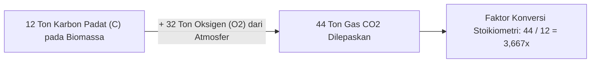
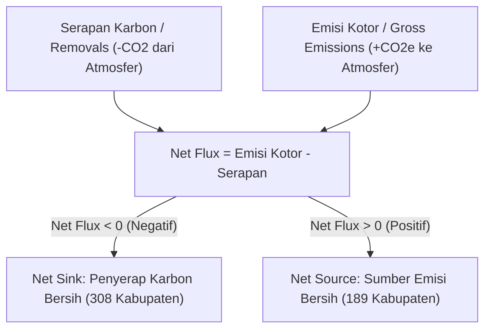
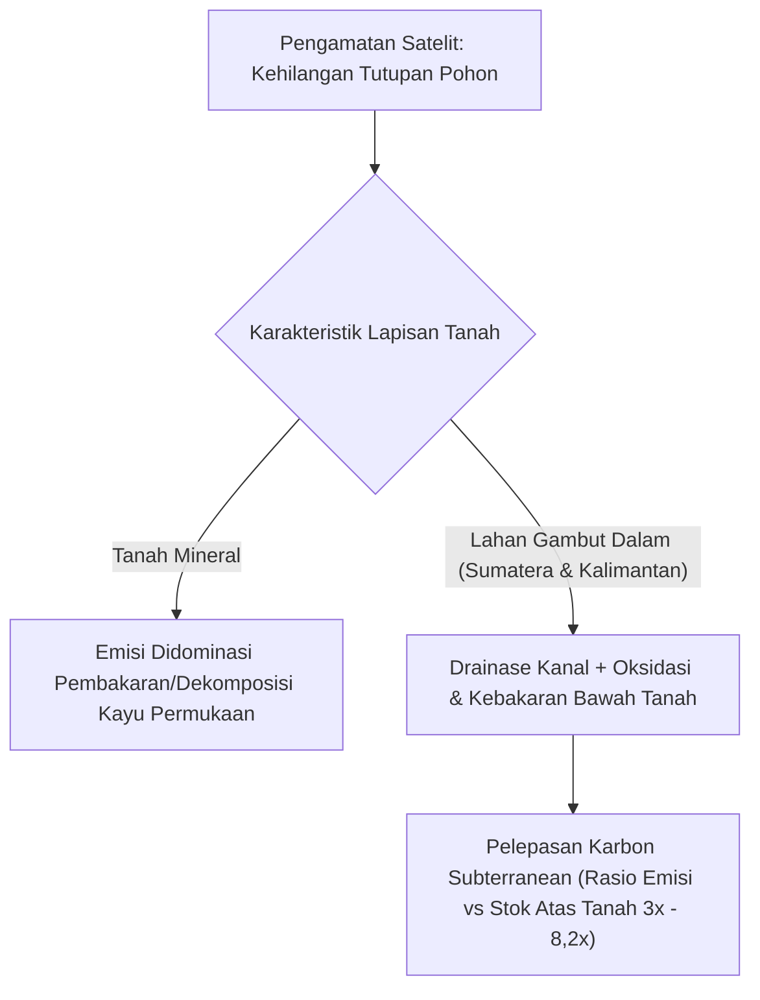
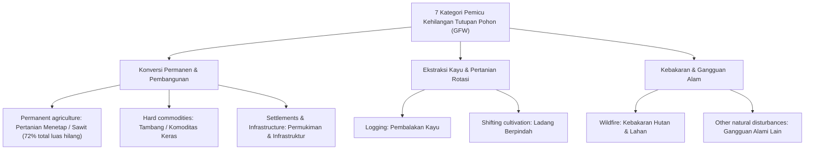
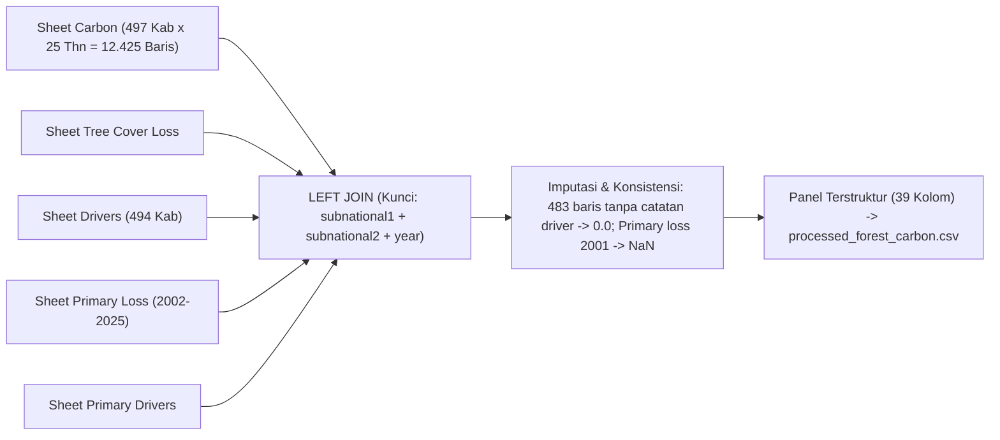

# Konsep Domain Kehutanan & Akuntansi Emisi Karbon

Dokumen ini menjelaskan konsep dasar ekologi hutan, kimia emisi karbon, klasifikasi pemicu deforestasi, serta proses pembentukan dataset panel dalam proyek **Carbonara** agar dapat dipahami oleh pembaca lintas disiplin tanpa latar belakang kehutanan.

---

## Daftar Isi

- [1. Konteks Kebijakan dan Target FOLU Net Sink 2030](#1-konteks-kebijakan-dan-target-folu-net-sink-2030)
- [2. Satuan Pengukuran](#2-satuan-pengukuran)
- [3. Hukum Stoikiometri dan Faktor Konversi 44 per 12](#3-hukum-stoikiometri-dan-faktor-konversi-44-per-12)
- [4. Neraca Karbon Emisi Kotor Serapan dan Net Flux](#4-neraca-karbon-emisi-kotor-serapan-dan-net-flux)
- [5. Hutan Primer vs Non-Primer dan Karbon Bawah Permukaan](#5-hutan-primer-vs-non-primer-dan-karbon-bawah-permukaan)
  - [5.1 Hutan Primer vs Hutan Non-Primer](#51-hutan-primer-vs-hutan-non-primer)
  - [5.2 Biomassa Atas Tanah vs Karbon Bawah Permukaan pada Lahan Gambut](#52-biomassa-atas-tanah-vs-karbon-bawah-permukaan-pada-lahan-gambut)
- [6. Tujuh Kategori Pemicu Kehilangan Tutupan Pohon](#6-tujuh-kategori-pemicu-kehilangan-tutupan-pohon)
- [7. Sumber Data dan Pembentukan Panel Spatio-Temporal](#7-sumber-data-dan-pembentukan-panel-spatio-temporal)

---

## 1. Konteks Kebijakan dan Target FOLU Net Sink 2030

Indonesia menyimpan cadangan karbon daratan (*terrestrial carbon*) yang signifikan pada ekosistem hutan tropis dataran rendah maupun lahan gambut. Melalui Peraturan Presiden No. 98 Tahun 2021 dan Keputusan Menteri LHK No. SK.168/2022 tentang Rencana Operasional *Indonesia's FOLU Net Sink 2030*, pemerintah menetapkan sasaran agar pada tahun 2030 sektor kehutanan dan penggunaan lahan lainnya (*Forestry and Other Land Use* / FOLU) mencapai kondisi di mana serapan gas rumah kaca lebih besar daripada emisinya (neraca bersih $\le -140\text{ Mt CO}_2\text{e}$ per tahun).

Tantangan utama di tingkat sub-nasional adalah heterogenitas geografis antar **497 kabupaten/kota**:
- Sebagian wilayah di Sumatera dan Kalimantan didominasi konversi lahan untuk perkebunan skala besar serta kebakaran berulang di atas tanah gambut dalam.
- Wilayah Indonesia bagian timur (Papua dan sebagian Kalimantan pedalaman) didominasi hutan alam primer berkerapatan karbon tinggi dengan tekanan dari pembalakan kayu dan ladang rotasi.
- Wilayah perkotaan di Jawa dan Bali umumnya memiliki luas tutupan hutan awal yang lebih kecil dengan pemicu utama berupa perluasan permukiman dan infrastruktur.

---

## 2. Satuan Pengukuran

| Simbol / Satuan | Kepanjangan | Definisi | Padanan Skala |
|---|---|---|---|
| **`ha`** | Hektare | Satuan luas area sebesar $10.000\text{ m}^2$ ($100\text{ m} \times 100\text{ m}$) | Sekitar $1{,}4\times$ luas lapangan sepak bola standar internasional |
| **`Mg`** | Megagram | $10^6\text{ gram} = 1.000\text{ kg}$ | Setara tepat dengan **$1\text{ ton metrik}$** |
| **`Mg C`** | Megagram Karbon | Massa atom karbon padat murni di dalam biomassa vegetasi | Digunakan untuk mengukur cadangan stok karbon tegakan pohon |
| **`Mg CO₂e`** | Megagram $\text{CO}_2$ Ekuivalen | Massa gas rumah kaca yang dilepaskan ke atmosfer, dinormalisasi terhadap potensi pemanasan $\text{CO}_2$ | Setara **$1\text{ ton CO}_2\text{e}$** |
| **`Mt CO₂e`** | Megaton $\text{CO}_2\text{e}$ | $10^6\text{ Mg CO}_2\text{e}$ ($1\text{ juta ton}$) | Skala emisi tahunan tingkat provinsi atau nasional |
| **`Gt CO₂e`** | Gigaton $\text{CO}_2\text{e}$ | $10^9\text{ Mg CO}_2\text{e}$ ($1\text{ miliar ton}$) | Skala akumulasi emisi multi-dekade (2001–2025 nasional $\approx 23{,}59\text{ Gt}$) |
| **`Mg C/ha`** | Densitas Karbon | Rata-rata cadangan karbon padat per hektare tutupan pohon | Menunjukkan kepadatan biomassa tegakan di suatu wilayah |
| **`Mg CO₂e/ha`** | Intensitas Emisi | Total gas emisi yang dilepaskan setiap $1\text{ ha}$ tutupan pohon hilang | Mengukur tingkat dampak emisi per satuan luas kerusakan |

---

## 3. Hukum Stoikiometri dan Faktor Konversi 44 per 12

Pada perhitungan fitur `potential_co2e` di [`app.py`](../app.py#L109) dan [`carbonara_notebook.ipynb`](../carbonara_notebook.ipynb), stok karbon padat (`Mg C`) dikonversi menjadi ekuivalen gas karbon dioksida (`Mg CO₂e`) dengan faktor pengali **`44 / 12`** ($\approx 3{,}6667$).

Konversi ini mengikuti persamaan reaksi oksidasi karbon ketika biomassa terbakar atau mengalami dekomposisi biologis:

$$\text{C} + \text{O}_2 \longrightarrow \text{CO}_2$$

- Massa atom relatif Karbon ($\text{C}$) = $12\text{ g/mol}$
- Massa atom relatif Oksigen ($\text{O}$) = $16\text{ g/mol}$, sehingga massa molekul $\text{CO}_2 = 12 + (2 \times 16) = 44\text{ g/mol}$

Setiap **$1\text{ Mg C}$** yang teroksidasi sempurna menghasilkan **$3{,}67\text{ Mg CO}_2\text{e}$** di atmosfer karena setiap atom karbon mengikat dua atom oksigen dari udara.

---

## 4. Neraca Karbon Emisi Kotor Serapan dan Net Flux

Dalam akuntansi karbon kehutanan, dinamika fluks gas rumah kaca dihitung melalui tiga komponen:

1. **Emisi Kotor (*Gross Emissions*):** Total pelepasan $\text{CO}_2\text{e}$ akibat hilangnya tutupan pohon (konversi lahan, penebangan, maupun kebakaran).
2. **Serapan (*Removals*):** Total $\text{CO}_2$ yang diserap kembali oleh pertumbuhan vegetasi hutan melalui fotosintesis.
3. **Emisi Bersih (*Net Flux*):** Selisih antara emisi kotor dan serapan tahunan rata-rata:

$$\text{Net Flux} = \text{Emisi Kotor} - \text{Serapan}$$

- **Agregat Nasional (Rata-rata GFW 2001–2025):** Emisi kotor **`943,5 Mt CO₂e/tahun`** dikurangi serapan **`594,4 Mt CO₂/tahun`** menghasilkan *net flux* nasional **`+349,1 Mt CO₂e/tahun`** (**Net Source**).
- **Distribusi Spasial:** Meskipun neraca agregat nasional bernilai positif, **308 dari 497 kabupaten/kota (62%)** berstatus **Net Sink**, sedangkan defisit nasional dipicu oleh konsentrasi kehilangan tutupan dan kebakaran pada **189 kabupaten Net Source**.

---

## 5. Hutan Primer vs Non-Primer dan Karbon Bawah Permukaan

### 5.1 Hutan Primer vs Hutan Non-Primer
- **Hutan Primer (*Primary Forest*):** Hutan tropis alami yang belum mengalami pembukaan atau pembalakan masif dalam sejarah modern, dicirikan oleh struktur kanopi tua dan cadangan karbon padat yang tinggi.
- **Hutan Non-Primer:** Hutan sekunder hasil regenerasi, semak belukar, maupun hutan tanaman.
- Berdasarkan dekomposisi *Non-Negative Least Squares* (NNLS) pada data Indonesia (2002–2025), kehilangan $1\text{ ha}$ **hutan primer** berkorelasi dengan rata-rata emisi **`1.170 Mg CO₂e/ha`**, hampir **dua kali lipat** dibandingkan hutan non-primer (**`629 Mg CO₂e/ha`**).

### 5.2 Biomassa Atas Tanah vs Karbon Bawah Permukaan pada Lahan Gambut
Penginderaan jauh optik umumnya hanya mengukur **Biomassa Atas Tanah (*Aboveground Biomass / AGB*)**—yakni batang, cabang, dan kanopi pohon yang terlihat oleh satelit. Secara teoritis, jika sebuah wilayah memiliki densitas karbon atas tanah sebesar $100\text{ Mg C/ha}$, pelepasan emisi dari pembakaran vegetasi permukaannya berkisar $100 \times \frac{44}{12} \approx 367\text{ Mg CO}_2\text{e/ha}$.

Namun pada beberapa kabupaten di Riau, Sumatera Selatan, Kalimantan Tengah, dan Kalimantan Selatan (misalnya Hulu Sungai Utara, Ogan Komering Ilir, Barito Kuala, dan Pulang Pisau), data mencatat pelepasan emisi aktual hingga **3× sampai 8× lipat** di atas stok karbon biomassa atas tanahnya.

Selisih tersebut berasal dari **karbon bawah permukaan pada lahan gambut (*subterranean peat*)** yang mengering akibat pembuatan kanal dan ikut terbakar saat terjadi karhutla. Karena peta spasial kedalaman gambut tidak disertakan dalam berkas input GFW, **Carbonara** menangkap karakteristik lahan gambut melalui dua mekanisme:
1. Fitur **`hist_intensity`** (rekam jejak intensitas emisi per hektare historis suatu kabupaten) sebagai prediktor pada model *machine learning*.
2. Pemeringkatan **`intensity_hotspots.csv`** untuk mengidentifikasi wilayah dengan rasio pelepasan emisi melampaui ekspektasi stok biomassa atas tanah.

---

## 6. Tujuh Kategori Pemicu Kehilangan Tutupan Pohon

Global Forest Watch mengklasifikasikan penyebab hilangnya tutupan pohon tahunan ke dalam tujuh kategori aktivitas resmi:

---

## 7. Sumber Data dan Pembentukan Panel Spatio-Temporal

Data mentah berasal dari **Global Forest Watch (GFW)** tingkat *Subnational 2* Indonesia, rilis **`v20260427`**, menggunakan ambang batas kerapatan tajuk **`threshold = 30%`**. Seluruh data dari 5 *worksheet* pada [`IDN.xlsx`](../IDN.xlsx) digabungkan menjadi panel seimbang berdimensi **497 kabupaten/kota × 25 tahun (`2001–2025`) = 12.425 observasi**.

### Tiga Keputusan Teknis pada Pengolahan Panel
1. **Penggabungan dengan `LEFT JOIN`:** Sheet *carbon* mencatat **497** wilayah administratif, sedangkan sheet *drivers* hanya mencatat **494** wilayah (3 wilayah perkotaan/kepulauan tidak memiliki catatan aktivitas *driver*). Penggabungan menggunakan `LEFT JOIN` bertumpu pada sheet *carbon* agar ke-497 wilayah tetap utuh dalam agregasi nasional; baris tanpa catatan *driver* (483 baris) diisi dengan `0.0`.
2. **Disambiguasi Kunci Komposit:** Terdapat **497** pasangan provinsi–kabupaten/kota namun hanya **496** nama `subnational2` yang unik (terdapat nama wilayah yang sama di provinsi berbeda). Seluruh operasi *grouping*, *join*, dan pemetaan spasial wajib memakai pasangan kunci **`(subnational1, subnational2)`**.
3. **Verifikasi Konsistensi (`0,9983`):** Perbandingan antara penjumlahan 7 kolom pemicu (`total_loss_ha`) dan total kehilangan tutupan satelit (`tc_loss_ha`) menunjukkan rasio kecocokan nasional sebesar **`0,9983` (99,83%)**. Sementara itu, data `primary_loss_ha` baru tersedia di GFW mulai tahun `2002`, sehingga nilai tahun `2001` dipertahankan sebagai `NaN` (didukung secara *native* oleh `HistGradientBoostingRegressor`).
