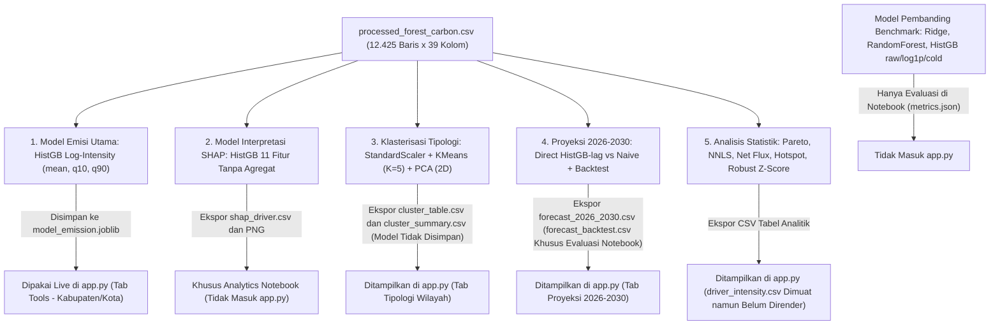
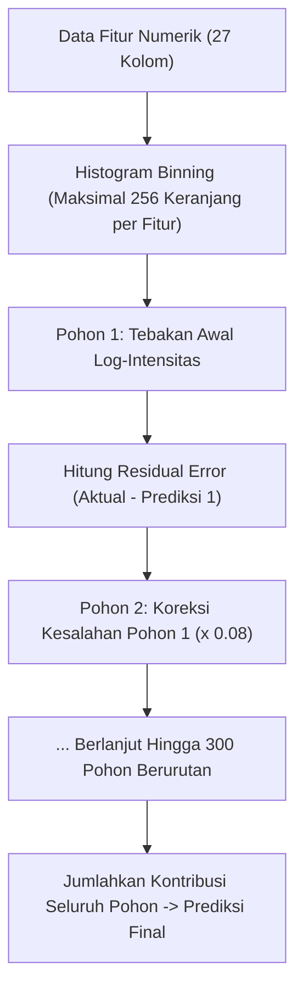
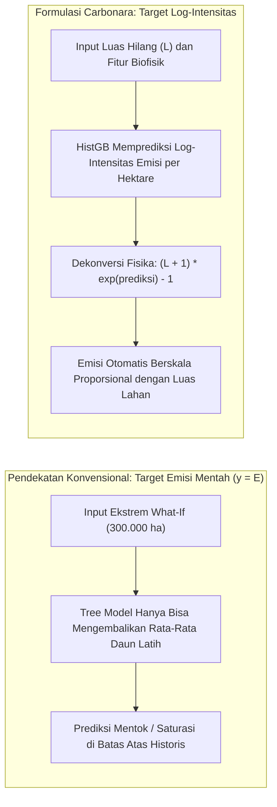
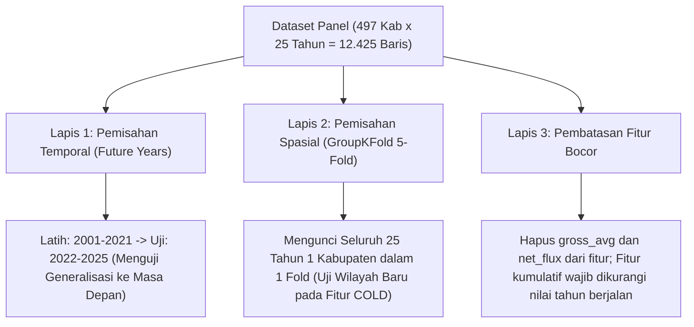
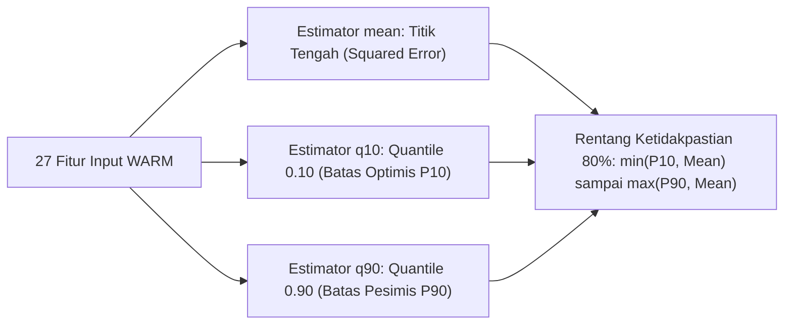
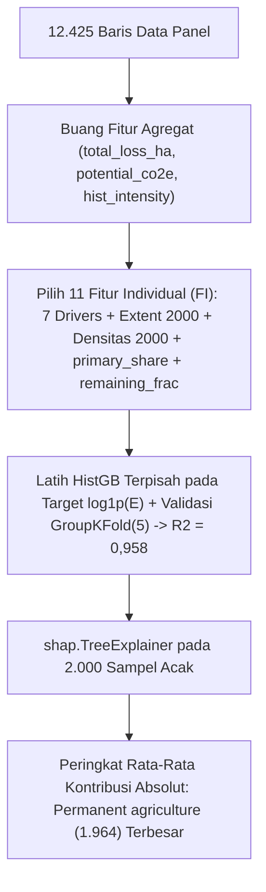
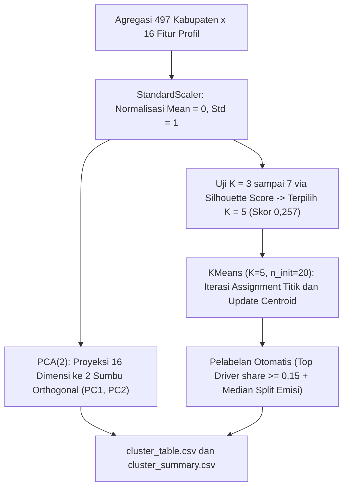
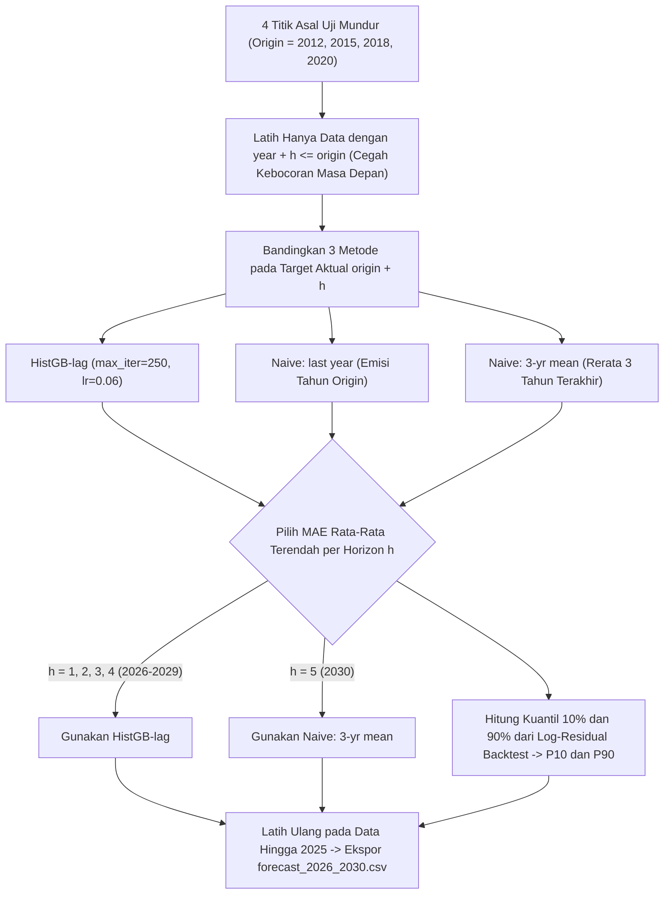

# Pemodelan Machine Learning, Metode Data Mining, dan Model Card

Dokumen ini memaparkan seluruh proses pemodelan dan analisis di [`carbonara_notebook.ipynb`](../carbonara_notebook.ipynb), menjelaskan cara kerja algoritma dan logika matematis di balik setiap tahap, serta memetakan secara tegas model mana yang berjalan di aplikasi [`app.py`](../app.py) dan model mana yang hanya digunakan untuk analisis maupun evaluasi di notebook.

---

## Daftar Isi

- [1. Peta Keseluruhan Proses Modeling dan Status Deployment](#1-peta-keseluruhan-proses-modeling-dan-status-deployment)
- [2. Model Utama Prediksi Emisi dan Simulasi What-If](#2-model-utama-prediksi-emisi-dan-simulasi-what-if)
  - [2.1 Cara Kerja Algoritma HistGradientBoosting](#21-cara-kerja-algoritma-histgradientboosting)
  - [2.2 Formulasi Target Log-Intensitas dan Masalah Tree Saturation](#22-formulasi-target-log-intensitas-dan-masalah-tree-saturation)
  - [2.3 Rekayasa Fitur Mode COLD dan Mode WARM](#23-rekayasa-fitur-mode-cold-dan-mode-warm)
  - [2.4 Protokol Validasi Anti-Kebocoran Data](#24-protokol-validasi-anti-kebocoran-data)
  - [2.5 Benchmark Evaluasi Model di Notebook](#25-benchmark-evaluasi-model-di-notebook)
  - [2.6 Regresi Kuantil P10 dan P90 untuk Interval Ketidakpastian](#26-regresi-kuantil-p10-dan-p90-untuk-interval-ketidakpastian)
- [3. Model Interpretasi SHAP Khusus Analytics Notebook](#3-model-interpretasi-shap-khusus-analytics-notebook)
- [4. Model Klasterisasi Tipologi Wilayah dengan K-Means dan PCA](#4-model-klasterisasi-tipologi-wilayah-dengan-k-means-dan-pca)
  - [4.1 Pembentukan 16 Fitur Profil dan StandardScaler](#41-pembentukan-16-fitur-profil-dan-standardscaler)
  - [4.2 Pemilihan Jumlah Klaster dengan Silhouette Score dan Cara Kerja K-Means](#42-pemilihan-jumlah-klaster-dengan-silhouette-score-dan-cara-kerja-k-means)
  - [4.3 Proyeksi Visual 2D dengan PCA dan Profil 5 Klaster](#43-proyeksi-visual-2d-dengan-pca-dan-profil-5-klaster)
- [5. Model Proyeksi Multi-Horizon 2026 sampai 2030 dan Backtesting](#5-model-proyeksi-multi-horizon-2026-sampai-2030-dan-backtesting)
  - [5.1 Mengapa Direct Multi-Horizon dan Mengapa Fitur Lag](#51-mengapa-direct-multi-horizon-dan-mengapa-fitur-lag)
  - [5.2 Logika Rolling-Origin Backtest dan Pemilihan Metode Terbaik](#52-logika-rolling-origin-backtest-dan-pemilihan-metode-terbaik)
- [6. Metode Statistik dan Data Mining Pendukung Lainnya](#6-metode-statistik-dan-data-mining-pendukung-lainnya)
  - [6.1 Analisis Konsentrasi Pareto](#61-analisis-konsentrasi-pareto)
  - [6.2 Estimasi Intensitas Pemicu dengan NNLS](#62-estimasi-intensitas-pemicu-dengan-nnls)
  - [6.3 Neraca Net Flux dan Hotspot Karbon Tersembunyi](#63-neraca-net-flux-dan-hotspot-karbon-tersembunyi)
  - [6.4 Deteksi Anomali Ekstrem dengan Robust Z-Score](#64-deteksi-anomali-ekstrem-dengan-robust-z-score)
- [7. Model Card dan Keterbatasan Ilmiah Prototipe](#7-model-card-dan-keterbatasan-ilmiah-prototipe)

---

## 1. Peta Keseluruhan Proses Modeling dan Status Deployment

Di dalam [`carbonara_notebook.ipynb`](../carbonara_notebook.ipynb) terdapat **empat proses pemodelan *machine learning*** (ditambah satu optimasi regresi linear terkendala *NNLS*), namun tidak semuanya disimpan sebagai berkas model atau ditampilkan di [`app.py`](../app.py). Pemetaan berikut merangkum peran masing-masing model:

| Proses Modeling / Analisis | Fitur yang Dipakai | Disimpan ke `.joblib`? | Status di `app.py` |
|---|---|---|---|
| **HistGB Log-Intensity (`WARM`: `mean`, `q10`, `q90`)** | 27 fitur `WARM` | **Ya** (`model_emission.joblib`) | **Inferensi live** di Tab *Tools* (level Kabupaten/Kota) |
| **Model Benchmark (`Ridge`, `RF`, `HistGB raw/log1p/cold`)** | 25 fitur `COLD` | Tidak | **Tidak ada di `app.py`** — hanya untuk evaluasi pemilihan model di notebook |
| **Model Interpretasi SHAP (`HistGB` tanpa agregat)** | 11 fitur `FI` | Tidak | **Tidak ada di `app.py`** — khusus analisis kepentingan pemicu di notebook |
| **Klasterisasi Tipologi (`StandardScaler` + `KMeans` + `PCA`)** | 16 fitur agregat kabupaten | Tidak | **Output tabelnya** (`cluster_table.csv`, `cluster_summary.csv`) tampil di Tab *Tipologi Wilayah* |
| **Proyeksi Multi-Horizon (`HistGB-lag` vs Naive)** | 17 fitur lag & *rolling* (`FF`) | Tidak | **Output proyeksinya** (`forecast_2026_2030.csv`) tampil di Tab *Proyeksi*; `forecast_backtest.csv` hanya di notebook |
| **Estimasi Intensitas (`NNLS`)** | 7 *drivers* & primer/non-primer | Tidak | `driver_intensity.csv` dimuat saat startup, belum dirender sebagai grafik terpisah |

---

## 2. Model Utama Prediksi Emisi dan Simulasi What-If

Model inti sistem ini berfungsi memprediksi emisi kotor tahunan ($\text{Mg CO}_2\text{e}$) suatu kabupaten berdasarkan rencana atau skenario luas pembukaan tutupan lahan per pemicu dan porsi hutan primer.

### 2.1 Cara Kerja Algoritma HistGradientBoosting

Model utama dibangun menggunakan `HistGradientBoostingRegressor` (`max_iter=300`, `learning_rate=0.08`, `random_state=42`) dari `scikit-learn` (terinspirasi dari arsitektur LightGBM). Berbeda dengan model linear yang hanya menggambar satu bidang datar, atau *Random Forest* yang melatih banyak pohon secara acak dan terpisah, *Histogram-based Gradient Boosting* bekerja dalam dua mekanisme utama:

1. **Diskritisasi Histogram (*Binning*):** Nilai numerik kontinu dari setiap fitur dikelompokkan terlebih dahulu ke dalam maksimal 256 keranjang (*bins*). Dengan begitu, saat mencari titik belah pohon terbaik, algoritma cukup memindai 256 batas keranjang alih-alih mengurutkan ribuan angka mentah—membuat pelatihan sangat cepat dan hemat memori.
2. **Pembelajaran Sekuensial Berbasis Residual (*Boosting*):** Algoritma membangun hingga 300 pohon keputusan secara berurutan. Pohon pertama membuat tebakan awal, lalu pohon kedua tidak menebak target asli dari nol, melainkan dilatih khusus untuk **memprediksi dan memperbaiki selisih kesalahan (*residual error*)** dari pohon pertama, pohon ketiga memperbaiki sisa kesalahan gabungan pohon 1 dan 2, dan seterusnya dengan bobot langkah `learning_rate = 0.08`.
3. **Dukungan Nilai Kosong (`NaN`) Secara Native:** Di dataset GFW Indonesia, `primary_loss_ha` bernilai `NaN` pada tahun `2001` dan `hist_intensity` bernilai `NaN` sebelum kehilangan kumulatif melebihi `50 ha`. `HistGradientBoostingRegressor` mampu mempelajari arah percabangan khusus untuk `NaN` tanpa perlu imputasi paksa.

---

### 2.2 Formulasi Target Log-Intensitas dan Masalah Tree Saturation

Kesalahan klasik pada pemodelan pohon keputusan untuk simulasi skenario adalah melatih model langsung pada target mentah ($y = \text{gross\_emissions\_Mg\_CO2e}$).

- **Mengapa Target Mentah Gagal Saat Simulasi Ekstrem?** Pohon keputusan bekerja dengan mempartisi ruang data latih menjadi kotak-kotak wilayah dan mengembalikan rata-rata target di dalam kotak tersebut. Akibatnya, **model berbasis pohon tidak dapat melakukan ekstrapolasi di luar nilai maksimum data latih**. Jika pengguna memasukkan skenario pembukaan 300.000 ha pada kabupaten yang rekor historisnya hanya 30.000 ha, model target mentah akan mengalami **saturasi (*tree saturation*)** dan mengeluarkan angka datar yang terlalu kecil.

- **Solusi Carbonara:** Secara fisika, total emisi merupakan hasil kali luas kehilangan tutupan ($L = \text{total\_loss\_ha}$) dengan intensitas emisi per hektare wilayah tersebut. Oleh karena itu, model dilatih memprediksi **log-intensitas emisi**:

$$y_{\text{log}} = \ln\left(\frac{E + 1}{\text{total\_loss\_ha} + 1}\right)$$

Saat inferensi, prediksi $\hat{y}_{\text{log}}$ dikembalikan ke skala emisi kotor ($\text{Mg CO}_2\text{e}$):

$$\hat{E} = \max\left((\text{total\_loss\_ha} + 1) \cdot \exp(\hat{y}_{\text{log}}) - 1,\; 0\right)$$

**Keuntungan matematis:** Luas lahan yang dimasukkan di simulator selalu menskalakan total emisi secara fisika, sementara *gradient boosting* berfokus mempelajari faktor pengali intensitas (hutan primer, pemicu karhutla/sawit, serta karakteristik gambut).

---

### 2.3 Rekayasa Fitur Mode COLD dan Mode WARM

Model utama menggunakan **27 fitur (`WARM`)** yang terbagi menjadi dua lapis:

1. **25 Fitur `COLD` (Tanpa Riwayat Emisi Wilayah):**
   - **7 Pemicu Mentah (ha):** `Hard commodities`, `Logging`, `Other natural disturbances`, `Permanent agriculture`, `Settlements & Infrastructure`, `Shifting cultivation`, `Wildfire`.
   - **Agregat dan Rasio Pemicu:** `total_loss_ha`, `agri_loss_ratio`, `wildfire_ratio`, `loss_extent_ratio`, dan jangkar stoikiometri atas tanah `potential_co2e` ($\text{total\_loss\_ha} \times \text{densitas}_{2000} \times \frac{44}{12}$).
   - **Kualitas Tutupan:** `primary_loss_ha` dan `primary_share`.
   - **Dinamika Sisa Tutupan Tahun Sebelumnya:** `cum_loss_prior_ha`, `remaining_extent_ha`, `remaining_frac`, `loss_remaining_ratio`, `remaining_carbon_Mg_C`.
   - **Baseline Statis dan Waktu:** `area_ha`, `forest_cover_frac`, `umd_tree_cover_extent_2000__ha`, `gfw_aboveground_carbon_stocks_2000__Mg_C`, `avg_gfw_aboveground_carbon_stocks_2000__Mg_C_ha-1`, serta `year`.
2. **2 Fitur Tambahan `WARM` (Proksi Karbon Bawah Permukaan / Gambut):**

$$\text{hist\_intensity}_t = \begin{cases} \dfrac{\sum_{t'=2001}^{t-1} E_{t'}}{\left(\sum_{t'=2001}^{t-1} \text{total\_loss\_ha}_{t'}\right) + 1}, & \text{jika } \sum_{t'=2001}^{t-1} \text{total\_loss\_ha}_{t'} > 50\text{ ha} \\ \text{NaN}, & \text{selainnya} \end{cases}$$

$$\text{hist\_intensity\_x\_loss}_t = \text{hist\_intensity}_t \times \text{total\_loss\_ha}_t$$

Mode `COLD` digunakan pada validasi silang antar-kabupaten agar model tidak mengandalkan identitas riwayat emisi daerah tertentu. Mode **`WARM`** dipakai pada model produksi (`model_emission.joblib`) karena seluruh 497 kabupaten memiliki rekam jejak historis hingga tahun `2025`.

---

### 2.4 Protokol Validasi Anti-Kebocoran Data

Pada data panel spasio-temporal, pemisahan acak (`train_test_split` biasa) menyebabkan *data leakage*: observasi dari kabupaten yang sama pada tahun berdekatan masuk ke set latih dan set uji sekaligus sehingga model terlihat akurat hanya karena menghafal karakteristik lokal. Untuk mencegah kebocoran, notebook menerapkan tiga lapis validasi:

---

### 2.5 Benchmark Evaluasi Model di Notebook

*(Catatan: model pembanding `Ridge`, `RandomForest`, dan varian `HistGB` selain `WARM` **hanya dieksekusi di notebook untuk membuktikan keunggulan formulasi target** dan tidak dimasukkan ke `app.py`.)*

| Model | $R^2$ Future Years (2022–2025) | MAE Future Years ($\text{Mg CO}_2\text{e}$) | $R^2$ Unseen Kabupaten | MAE Unseen Kabupaten ($\text{Mg CO}_2\text{e}$) |
|---|---:|---:|---:|---:|
| Ridge (`cold features`) | 0.917 | 343,294 | 0.973 | 331,676 |
| RandomForest raw target (`cold`) | 0.952 | 180,642 | 0.944 | 278,700 |
| HistGB raw target (`cold`) | 0.939 | 184,962 | 0.942 | 283,099 |
| HistGB `log1p` target (`cold`) | 0.966 | 170,128 | 0.931 | 274,311 |
| HistGB intensity target (`cold`) | 0.976 | 155,060 | **0.960** | **251,226** |
| **HistGB intensity target (`WARM`, deployed)** | **0.979** | **137,609** | — | — |

**Temuan penting:**
- **Mengapa MAE lebih diutamakan dari $R^2$:** Pada uji spasial, `Ridge` memperoleh $R^2 = 0{,}973$ karena varians didominasi beberapa kabupaten beremisi raksasa, namun rata-rata kesalahan absolutnya (`MAE = 331.676`) jauh lebih buruk daripada model berbasis pohon.
- **Efek transformasi log-intensitas:** Pada `HistGB (cold)`, perubahan dari target mentah ke log-intensitas memangkas MAE uji waktu dari `184.962` menjadi `155.060` ($\approx -16{,}2\%$) dan MAE kabupaten baru dari `283.099` menjadi `251.226` ($\approx -11{,}3\%$).
- **Efek proksi gambut (`WARM`):** Penambahan `hist_intensity` menurunkan MAE tahun `2022–2025` menjadi **`137.609 Mg CO₂e`** (pemangkasan kesalahan sekitar **~60%** dibandingkan baseline linear `Ridge`).
- **Permutation Importance (Uji 2022–2025):** Fitur dengan kontribusi terbesar terhadap penurunan $R^2$ target log-intensitas berturut-turut adalah `total_loss_ha` (`0.3467`), `gfw_aboveground_carbon_stocks_2000__Mg_C` (`0.0444`), `hist_intensity` (`0.0196`), `area_ha` (`0.0168`), dan `remaining_extent_ha` (`0.0135`).

---

### 2.6 Regresi Kuantil P10 dan P90 untuk Interval Ketidakpastian

Satu angka prediksi tunggal berisiko menimbulkan keyakinan berlebih pada kondisi alam yang berfluktuasi. Oleh karena itu, model produksi dilatih tiga kali menjadi satu bundel `model_emission.joblib`:

---

## 3. Model Interpretasi SHAP Khusus Analytics Notebook

> [!NOTE]
> **Status Deployment:** Model interpretasi SHAP **hanya dijalankan untuk analisis di notebook** (sel #43) guna memahami pendorong emisi secara adil; model maupun keluaran CSV/PNG-nya (`shap_driver.csv`, `shap_driver.png`) tidak digunakan di `app.py`.

### Logika Mengapa Harus Melatih Model Terpisah Tanpa Fitur Agregat
Pada model utama (`WARM`), terdapat fitur agregat `total_loss_ha` (penjumlahan 7 pemicu), `potential_co2e`, dan `hist_intensity`. Dalam teori permainan *Shapley Additive Explanations* (SHAP), ketika fitur agregat ikut masuk ke model, variabel agregat tersebut akan menyerap sebagian besar kredit kontribusi (*feature credit absorption*), sehingga kontribusi masing-masing pemicu spesifik (`Permanent agriculture`, `Wildfire`, `Logging`, dll.) tampak jauh lebih kecil dari dampak nyatanya.

- **Cara Kerja `TreeExplainer`:** Untuk setiap observasi, SHAP menghitung rata-rata perubahan prediksi saat sebuah fitur dimasukkan dibandingkan saat fitur tersebut absen pada seluruh kombinasi koalisi fitur yang mungkin di struktur pohon.
- **Hasil dan Makna Konseptual:** Pada evaluasi 2.000 sampel (`R² = 0.958` skala log pada `GroupKFold`), peringkat teratas adalah `Permanent agriculture` (`mean(|SHAP|) = 1.964`), `umd_tree_cover_extent_2000__ha` (`0.252`), `Shifting cultivation` (`0.216`), `Settlements & Infrastructure` (`0.213`), `Logging` (`0.175`), dan `Wildfire` (`0.089`). SHAP pada model ini menjelaskan **volume total emisi** (di mana perkebunan menetap dominan karena menyumbang 72% luas kehilangan), berbeda dengan NNLS yang menjelaskan **intensitas per hektare**.

---

## 4. Model Klasterisasi Tipologi Wilayah dengan K-Means dan PCA

> [!NOTE]
> **Status Deployment:** Model `StandardScaler`, `KMeans`, dan `PCA` dilatih di notebook (sel #46) dan **tidak disimpan ke `.joblib`**. Hasil penugasan klaster dan koordinat proyeksinya disimpan ke `cluster_table.csv` serta `cluster_summary.csv` untuk divisualisasikan di [`app.py`](../app.py) (sub-tab *Tipologi Wilayah*).

### 4.1 Pembentukan 16 Fitur Profil dan StandardScaler

Karena klasterisasi bertujuan mengelompokkan **karakter jangka panjang kabupaten** (bukan per tahun), data 12.425 baris diagregasi menjadi **497 baris profil kabupaten** dengan **16 fitur**:
- **7 fitur proporsi pemicu (`share_<driver>`):** porsi masing-masing pemicu terhadap total kehilangan 25 tahun (`0–1`).
- **6 fitur skala dan biofisik:** `log_total_emission`, `log_mean_loss`, `density`, `loss_extent_ratio`, `emission_per_ha`, `primary_share`.
- **3 fitur neraca dan tren:** `net_flux_per_ha` (di-*clip* `[-100, 100]`), `net_source` (`0` atau `1`), dan `trend_rel` (kemiringan regresi linier emisi tahunan dibagi rata-rata emisi kabupaten, di-*clip* `[-0.3, 0.3]`).

Sebelum masuk ke `KMeans` dan `PCA`, ke-16 fitur wajib melewati **`StandardScaler`** ($z = \frac{x - \mu}{\sigma}$). Langkah ini krusial karena `KMeans` mengukur kemiripan wilayah berdasarkan **jarak Euclidean**: tanpa standardisasi, fitur berskala puluhan hingga ratusan (seperti `emission_per_ha ~ 700` dan `density ~ 110`) akan mendominasi jarak dan meniadakan pengaruh fitur proporsi (`0–1`).

### 4.2 Pemilihan Jumlah Klaster dengan Silhouette Score dan Cara Kerja K-Means

1. **Pemilihan $K$ via *Silhouette Score*:** Notebook menguji $K = 3, 4, 5, 6, 7$ (`n_init=10`) dan menghitung *Silhouette Score* yang membandingkan kedekatan rata-rata titik ke anggota klasternya sendiri ($a$) terhadap jarak ke klaster tetangga terdekat ($b$): $s = \frac{b - a}{\max(a, b)}$. Skor tertinggi dicapai pada **$K = 5$ (`0.257`)** (`K=3: 0.241`, `K=4: 0.255`, `K=6: 0.242`, `K=7: 0.222`).
2. **Cara Kerja `KMeans` Final (`n_init=20`):** Algoritma menginisialisasi 5 titik pusat (*centroid*) di ruang 16 dimensi, mengelompokkan setiap kabupaten ke centroid terdekat, lalu memperbarui posisi centroid ke rata-rata anggotanya secara berulang hingga konvergen (diulang 20 kali dari titik awal berbeda untuk menghindari konvergensi lokal yang buruk).
3. **Aturan Pelabelan Otomatis Klaster:** Untuk setiap klaster, diambil hingga 3 pemicu teratas yang memiliki porsi rata-rata `>= 0.15` (atau pemicu tertinggi jika tidak ada yang mencapai `0.15`), lalu ditambahkan status `"emisi tinggi"` atau `"emisi rendah"` berdasarkan perbandingan terhadap median `mean_total_emission` antar-klaster.

### 4.3 Proyeksi Visual 2D dengan PCA dan Profil 5 Klaster

Karena ruang klasterisasi memiliki 16 dimensi, **Principal Component Analysis (`PCA(2)`)** memproyeksikan matriks terstandardisasi ke 2 sumbu orthogonal baru (`pc1`, `pc2`) yang menangkap kombinasi varians terbesar data, sehingga peta sebaran 497 kabupaten dapat digambar di `app.py`:

| Klaster | Jumlah Kab | Densitas Rata-rata (Mg C/ha) | Intensitas (Mg CO₂e/ha) | Porsi *Net Source* | Karakteristik Utama |
|---|---:|---:|---:|---:|---|
| **C1: Agrikultur/Sawit (emisi rendah)** | 209 | 93.0 | 610.3 | 2.9% | Ekspansi pertanian/perkebunan skala kecil dengan emisi total rendah |
| **C2: Agrikultur/Sawit (emisi tinggi)** | 142 | 113.1 | 671.1 | **100.0%** | Sentra agrikultur intensif beremisi tinggi |
| **C3: Infrastruktur + Agrikultur/Sawit (emisi rendah)** | 47 | 67.9 | 588.7 | 0.0% | Dominasi permukiman dan infrastruktur (`65,8%`) dengan tren menurun |
| **C4: Agrikultur/Sawit + Kebakaran (emisi tinggi)** | 28 | 108.6 | **782.0** | 78.6% | Zona gambut rawan kebakaran (`33,6%` wildfire) berintensitas tertinggi |
| **C5: Ladang Berpindah + Agrikultur + Pembalakan (emisi tinggi)** | 71 | **147.0** | 734.9 | 26.8% | Wilayah berhutan lebat pedalaman (porsi hutan primer `53,8%`) |

---

## 5. Model Proyeksi Multi-Horizon 2026 sampai 2030 dan Backtesting

> [!NOTE]
> **Status Deployment:** Lima model proyeksi `HistGB-lag` dilatih di notebook (sel #52) dan **tidak disimpan ke `.joblib`**. Angka proyeksi final (`forecast_2026_2030.csv`) ditampilkan pada tab *Proyeksi 2026–2030* di `app.py`, sedangkan matriks evaluasinya (`forecast_backtest.csv`) hanya digunakan untuk evaluasi di notebook dan dikecualikan melalui `.gitignore`.

### 5.1 Mengapa Direct Multi-Horizon dan Mengapa Fitur Lag

Terdapat dua pendekatan untuk meramal 5 tahun ke depan ($t+1$ hingga $t+5$):
- **Pendekatan Rekursif (*Recursive Forecasting*):** Melatih 1 model untuk menebak $t+1$, lalu memakai hasil tebakan tersebut sebagai masukan untuk menebak $t+2$, dan seterusnya. Kelemahannya adalah *error snowballing*: kesalahan kecil di tahun pertama ikut terakumulasi ke tahun-tahun berikutnya.
- **Pendekatan Langsung (*Direct Multi-Horizon Forecasting* — Dipakai di Carbonara):** Melatih **5 model terpisah** untuk masing-masing horizon $h \in \{1, 2, 3, 4, 5\}$, sehingga setiap model memetakan kondisi teramati di tahun asal ($t$) langsung ke target tahun $t+h$ ($\ln(1 + E_{t+h})$).

Karena pada saat meramal masa depan tidak diketahui luas pembukaan lahan di tahun mendatang, model proyeksi tidak menggunakan input skenario, melainkan **17 fitur deret waktu dan kondisi terkini (`FF`)**: `year`, emisi tahun $t$, dua nilai *lag* (`em_lag1`, `em_lag2`), rata-rata bergerak emisi 3 tahun dan 5 tahun (`em_roll3`, `em_roll5`), kehilangan tutupan (`total_loss_ha`, `loss_roll3`, `fire_roll3`), pemicu utama (`Permanent agriculture`, `Wildfire`, `Logging`), serta fitur statis/state (`extent_2000`, `density`, `hist_intensity`, `primary_loss_ha`, `remaining_frac`).

### 5.2 Logika Rolling-Origin Backtest dan Pemilihan Metode Terbaik

Hasil rata-rata evaluasi MAE across 4 origin (`2012`, `2015`, `2018`, `2020`):

| Horizon ($h$) | Tahun | MAE `HistGB-lag` | MAE `Naive: 3-yr mean` | MAE `Naive: last year` | Metode Terpilih | Total Proyeksi Nasional |
|---:|---:|---:|---:|---:|---|---:|
| `h = 1` | 2026 | **1,073,510** ($R^2=0.504$) | 1,126,261 | 1,127,628 | `HistGB-lag` | **690.5 Mt CO₂e** |
| `h = 2` | 2027 | **737,648** ($R^2=0.747$) | 948,756 | 919,966 | `HistGB-lag` | **741.2 Mt CO₂e** |
| `h = 3` | 2028 | **1,009,266** ($R^2=0.523$) | 1,143,748 | 1,151,516 | `HistGB-lag` | **777.0 Mt CO₂e** |
| `h = 4` | 2029 | **1,059,195** ($R^2=0.587$) | 1,297,061 | 1,167,083 | `HistGB-lag` | **684.4 Mt CO₂e** |
| `h = 5` | 2030 | 1,077,414 ($R^2=-0.127$) | **1,057,873** ($R^2=-0.454$) | 1,211,957 | `Naive: 3-yr mean` | **743.1 Mt CO₂e** |

Untuk membentuk interval ketidakpastian `p10` dan `p90` tanpa mengasumsikan distribusi error simetris, notebook mengumpulkan seluruh *log-residual* historis ($\ln(1 + y_{\text{aktual}}) - \ln(1 + \hat{y}_{\text{backtest}})$) dari metode pemenang di empat origin, mengambil persentil ke-10 (`q10`) dan ke-90 (`q90`), lalu menerapkannya ke proyeksi tahun `2026–2030` melalui transformasi `expm1(log1p(forecast) + q)`.

---

## 6. Metode Statistik dan Data Mining Pendukung Lainnya

### 6.1 Analisis Konsentrasi Pareto
- **Status:** Output (`pareto.csv`) ditampilkan di `app.py` pada tab *Peta & Prioritas* (level Nasional).
- **Logika:** Mengurutkan total emisi kumulatif 25 tahun (`23,59 Gt CO₂e`) dari kontributor terbesar ke terkecil lalu menghitung proporsi kumulatif. Ditemukan bahwa **86 dari 497 kabupaten (`17,3%`) menyumbang `80%` emisi kumulatif nasional** (dipimpin oleh Pelalawan `3,45%`, Ogan Komering Ilir `3,41%`, Ketapang `2,88%`, Musi Banyuasin `2,65%`, dan Kutai Timur `2,56%`).

### 6.2 Estimasi Intensitas Pemicu dengan NNLS
- **Status:** Hasil estimasi disimpan ke `driver_intensity.csv`; dimuat saat startup oleh `app.py` namun belum dirender sebagai grafik terpisah (angka primer vs non-primer dikutip pada keterangan di tab *Tren & Pemicu*).
- **Logika:** Regresi linear biasa (*OLS*) sering menghasilkan koefisien negatif yang mustahil secara fisika (penebangan tidak dapat mengurangi emisi kotor). Oleh karena itu digunakan *Non-Negative Least Squares* (`scipy.optimize.nnls`) dengan batasan $\beta_d \ge 0$:

$$\min_{\beta \ge 0} \sum_i \left(E_i - \sum_{d=1}^{7} \beta_d \cdot \text{luas}_{i,d}\right)^2$$

- **Hasil Utama:** Kehilangan hutan primer menghasilkan koefisien **`1.170 Mg CO₂e/ha`** dibandingkan hutan non-primer **`629 Mg CO₂e/ha`** (`1,86×`). Pada tingkat pemicu (`All`), koefisien tertinggi muncul pada `Logging` (`1.803`) dan `Wildfire` (`1.175`), diikuti `Permanent agriculture` (`652`) dan `Shifting cultivation` (`140`).

### 6.3 Neraca Net Flux dan Hotspot Karbon Tersembunyi
- **Status:** Kedua hasil analisis (`net_table.csv` dan `intensity_hotspots.csv`) ditampilkan pada tab *Emisi Bersih & Hotspot* di `app.py`.
- **Logika:**
  - *Net Flux* menyandingkan rata-rata tahunan emisi kotor dengan serapan GFW (`308` kabupaten *Net Sink* vs `189` kabupaten *Net Source*; agregat nasional `+349,1 Mt CO₂e/thn`).
  - *Hotspot* menyaring **365 kabupaten** dengan $\text{cum\_L} \ge 2.000\text{ ha}$ untuk menghindari pembagi kecil, lalu menghitung rasio emisi aktual per hektare terhadap potensi stok biomassa atas tanah ($\text{density} \times \frac{44}{12} + 1$). Rasio tertinggi tercatat pada daerah gambut dalam seperti Hulu Sungai Utara (`8,24×`), Ogan Komering Ilir (`7,42×`), Barito Kuala (`5,96×`), dan Pulang Pisau (`4,72×`).

### 6.4 Deteksi Anomali Ekstrem dengan Robust Z-Score
- **Status:** Output (`anomalies.csv`) ditampilkan di `app.py` pada tab *Deteksi Anomali* (khusus level Nasional).
- **Logika:** Pada data deret waktu yang mengandung bencana kebakaran besar, penggunaan *Mean* dan *Standard Deviation* konvensional akan terdistorsi oleh *outlier* sehingga lonjakan ekstrem justru gagal terdeteksi (*masking effect*). Oleh karena itu digunakan **Median** dan **MAD (*Median Absolute Deviation*)** pada skala log (`lg = log1p(E)`):

$$\text{MAD} = \text{median}\left(\left|lg - \text{median}(lg)\right|\right) + 0{,}05$$

$$Z_{\text{robust}} = 0{,}6745 \times \frac{lg - \text{median}(lg)}{\text{MAD}}$$

Konstanta `0.6745` menormalkan skala MAD agar setara dengan simpangan baku distribusi normal, sedangkan konstanta `+ 0.05` mencegah pembagian nol pada kabupaten yang emisinya nyaris konstan. Kejadian dengan `robust_z > 3.0` dan `E > 300.000 Mg CO₂e` menandai **20 kejadian ekstrem** (`11` di antaranya terjadi pada musim kemarau El Niño `2015–2016`, dengan `92,9%` volume emisi berasal dari `Kebakaran`).

---

## 7. Model Card dan Keterbatasan Ilmiah Prototipe

| Properti | Spesifikasi Model Utama yang Di-Deploy |
|---|---|
| **Artefak Model** | `model_emission.joblib` (`mean`, `q10`, `q90`) + `metadata_carbon.joblib` |
| **Algoritma dan Hyperparameter** | `HistGradientBoostingRegressor(max_iter=300, learning_rate=0.08, random_state=42)` |
| **Environment Pelatihan** | `Python 3.12.3`, `scikit-learn 1.9.1`, `pandas 3.0.6`, `numpy 2.5.3` |
| **Kegunaan yang Dimaksud** | Estimasi emisi kotor tahunan dan eksplorasi skenario *what-if* tingkat kabupaten |
| **Di Luar Cakupan** | Klaim kausal kebijakan, sertifikasi kredit karbon MRV, dan inventarisasi GRK resmi |

> [!WARNING]
> **Batasan Teknis dan Ilmiah yang Perlu Diperhatikan:**
> 1. **Target Emisi Berasal dari Model GFW:** Nilai `gross_emissions_Mg_CO2e` di `IDN.xlsx` merupakan output pemodelan spasial global GFW, bukan pengukuran fluks lapangan atau pelaporan resmi SIGN-SMART KLHK.
> 2. **Proksi Gambut Tidak Langsung:** Tidak adanya peta kedalaman gambut pada dataset input membuat efek gambut hanya didekati melalui rekam jejak historis (`hist_intensity`) dan rasio *hotspot*.
> 3. **Multikolinearitas pada NNLS (`driver_intensity.csv`):** Nilai `0.0` pada `Hard commodities`, `Settlements & Infrastructure`, dan `Other natural disturbances` di segmen `All` terjadi karena korelasi spasial-temporal dengan pemicu lain, bukan berarti aktivitas tersebut bebas emisi.
> 4. **Klasterisasi Bersifat Kontinum (`Silhouette = 0.257`):** Skor Silhouette di bawah `0.30` menandakan transisi karakter antar 5 klaster kabupaten bersifat gradasi (*soft boundary*).
> 5. **Proyeksi Jangka Panjang Tanpa Variabel Iklim:** Tanpa prediktor ENSO/IOD atau curah hujan, ketidakpastian meningkat pada horizon 5 tahun sehingga `Naive: 3-yr mean` lebih stabil pada proyeksi `2030`.
> 6. **Sifat Korelatif dan Valuasi Karbon Sederhana:** Simulator tidak melakukan *causal inference*, dan perhitungan valuasi finansial di tab *Skenario Mitigasi* (`avoided * harga_usd * Rp 16.000`) belum memperhitungkan *additionality*, *leakage*, *buffer pool*, atau biaya verifikasi MRV.
> 7. **Simulasi Level Nasional dan Provinsi di `app.py`:** Seperti dirinci di [`03-system-architecture.md`](03-system-architecture.md), inferensi model ML penuh hanya berjalan pada level `Kabupaten/Kota`, sedangkan level `Nasional` dan `Provinsi` memakai rata-rata intensitas historis (`avg_int`) dengan interval indikatif `0,75×–1,35×`.
