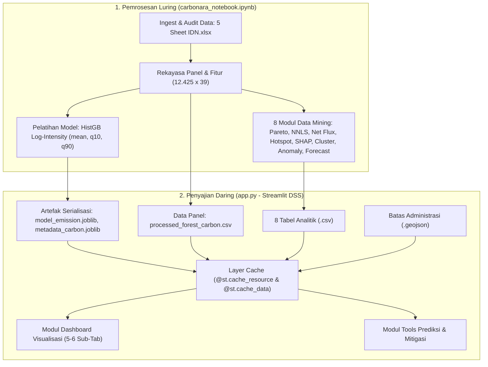
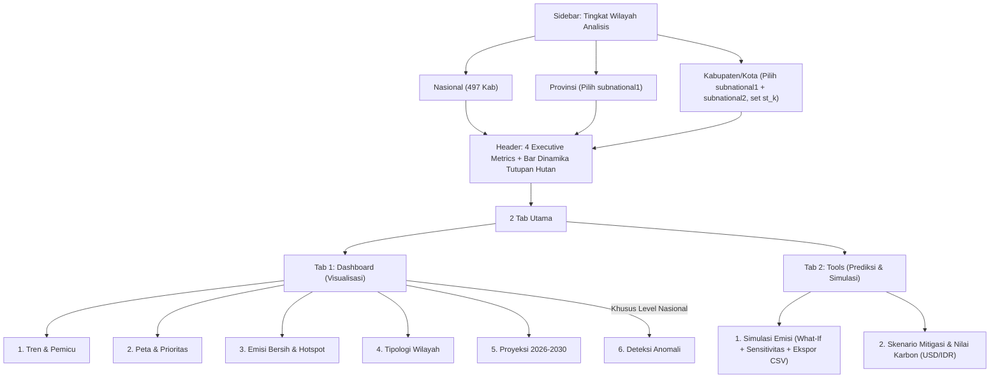
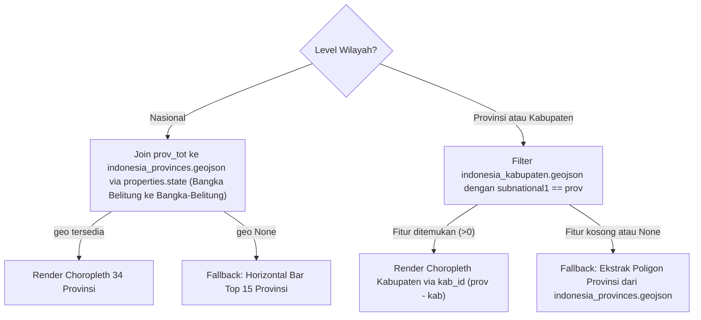
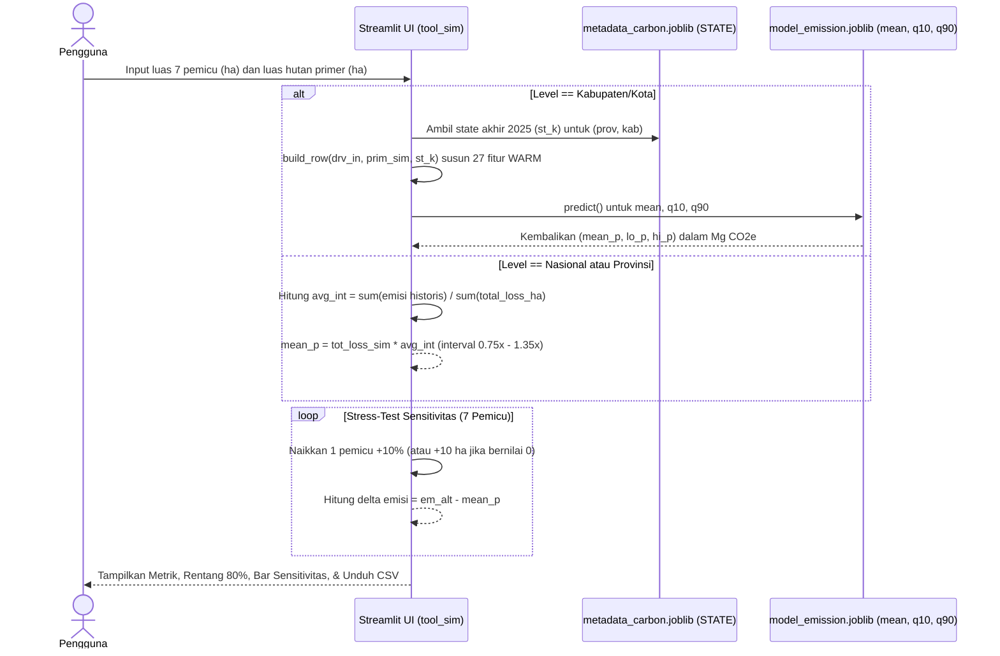

# Arsitektur Sistem & Implementasi Aplikasi (`app.py`)

Dokumen ini menjelaskan rancangan arsitektur perangkat lunak **Carbonara**, pemisahan antara pemrosesan luring dan penyajian daring, mekanisme *caching*, struktur komponen antarmuka [`app.py`](../app.py), alur resolusi geospasial, serta pertimbangan teknis untuk migrasi ke arsitektur web terpisah.

---

## Daftar Isi

- [1. Pola Arsitektur Pemrosesan Luring dan Penyajian Daring](#1-pola-arsitektur-pemrosesan-luring-dan-penyajian-daring)
- [2. Inisialisasi Aplikasi dan Manajemen Cache](#2-inisialisasi-aplikasi-dan-manajemen-cache)
- [3. Hierarki Navigasi dan Komponen Antarmuka](#3-hierarki-navigasi-dan-komponen-antarmuka)
  - [3.1 Ringkasan Eksekutif Header Metrics](#31-ringkasan-eksekutif-header-metrics)
  - [3.2 Modul 1 Dashboard Visualisasi](#32-modul-1-dashboard-visualisasi)
- [4. Alur Resolusi Peta Geospasial](#4-alur-resolusi-peta-geospasial)
- [5. Modul 2 Alur Inferensi dan Simulasi](#5-modul-2-alur-inferensi-dan-simulasi)
  - [5.1 Simulator Emisi What-If Engine dan Analisis Sensitivitas](#51-simulator-emisi-what-if-engine-dan-analisis-sensitivitas)
  - [5.2 Skenario Mitigasi dan Valuasi Ekonomi Karbon](#52-skenario-mitigasi-dan-valuasi-ekonomi-karbon)
- [6. Pemetaan Lengkap Artefak terhadap Antarmuka](#6-pemetaan-lengkap-artefak-terhadap-antarmuka)
- [7. Pertimbangan Migrasi ke Arsitektur Web Terpisah](#7-pertimbangan-migrasi-ke-arsitektur-web-terpisah)

---

## 1. Pola Arsitektur Pemrosesan Luring dan Penyajian Daring

Sistem mengadopsi prinsip *Separation of Concerns* dengan pola **Zero-Training Web Serving** (*artifact decoupling*) di atas alur kerja **CRISP-DM**:

1. **Pemrosesan Luring ([`carbonara_notebook.ipynb`](../carbonara_notebook.ipynb)):** Menjalankan seluruh proses ingest data Excel `IDN.xlsx`, pembersihan panel, rekayasa 27 fitur, pelatihan tiga model `HistGradientBoostingRegressor`, eksekusi delapan modul *data mining*, dan serialisasi keluaran ke berkas `.joblib` dan `.csv`.
2. **Penyajian Daring ([`app.py`](../app.py)):** Tidak menjalankan pelatihan model saat aplikasi dibuka. Aplikasi memuat artefak statis yang sudah tervalidasi melalui mekanisme *caching* Streamlit sehingga waktu muat awal dan respons simulasi berjalan instan.

---

## 2. Inisialisasi Aplikasi dan Manajemen Cache

Skrip [`app.py`](../app.py) (1.599 baris) menentukan lokasi berkas secara relatif terhadap direktori skrip (`BASE_DIR = os.path.dirname(os.path.abspath(__file__))`) agar portabel lintas sistem operasi (Windows, macOS, Linux, maupun kontainer cloud).

- **`load_artifacts()` (`@st.cache_resource`):** Memuat `artifacts/models/model_emission.joblib` (`models`) dan `artifacts/models/metadata_carbon.joblib` (`meta`) sekali ke memori server dan membagikannya antar-sesi pengguna.
- **`load_history()` (`@st.cache_data`):** Memuat data panel utama `data/processed/processed_forest_carbon.csv` (`df`).
- **Penanganan Kegagalan Inti:** Apabila model, metadata, atau panel utama gagal dimuat, aplikasi menampilkan pesan error melalui `st.error(...)` dan menghentikan eksekusi dengan `st.stop()`.
- **`load_csv(path)` (`@st.cache_data`):** Memuat berkas tabel analitik sekunder dari `artifacts/data/`; mengembalikan `None` apabila berkas tidak tersedia atau gagal dibaca sehingga antarmuka tab terkait dapat melakukan degradasi secara halus (*graceful degradation*) tanpa menghentikan seluruh aplikasi.
- **`load_geojson(mtime)` & `load_kabupaten_geojson(mtime)` (`@st.cache_data`):** Memuat `data/geo/indonesia_provinces.geojson` dan `data/geo/indonesia_kabupaten.geojson` dengan parameter *modification time* (`os.path.getmtime`) agar cache otomatis diperbarui apabila berkas peta berubah.

> [!NOTE]
> Berkas `driver_intensity.csv` dimuat saat inisialisasi ke variabel `di` (`app.py` baris 199), namun saat ini belum dirender sebagai grafik tersendiri pada UI; angka referensi intensitas hutan primer (`~1.170 Mg CO₂e/ha`) dan non-primer (`~629 Mg CO₂e/ha`) disajikan pada keterangan analitis di sub-tab *Tren & Pemicu*.

---

## 3. Hierarki Navigasi dan Komponen Antarmuka

Pengguna menentukan ruang lingkup wilayah analisis melalui kontrol *sidebar* (`Pemilihan Wilayah`), yang mengendalikan pemfilteran `active_df`, kartu ringkasan di *header*, daftar sub-tab yang tersedia, serta metode kalkulasi pada modul simulator.

### 3.1 Ringkasan Eksekutif Header Metrics
Bagian atas halaman menampilkan empat metrik utama untuk cakupan terpilih: emisi kotor tahun terakhir (`2025` beserta delta persentase terhadap `2024`), tahun puncak emisi tertinggi, total emisi kumulatif 25 tahun (`2001–2025`), dan rata-rata emisi tahunan. Di bawahnya ditampilkan grafik batang horizontal tumpuk (*stacked bar*) yang membandingkan luas **Sisa Tutupan Terjaga** terhadap **Tutupan Hilang** dibandingkan *baseline* tahun `2000`.

### 3.2 Modul 1 Dashboard Visualisasi

| Sub-Tab | Cakupan | Sumber Data | Visualisasi & Logika Antarmuka |
|---|---|---|---|
| **1. Tren & Pemicu** | Semua | `processed_forest_carbon.csv` | Grafik area emisi tahunan (`2001–2025`), grafik batang bertumpuk 7 pemicu per tahun, identifikasi pemicu dominan beserta rekomendasi kebijakan otomatis (`POLICY_REC`), akumulasi luas hilang per pemicu, grafik donat Hutan Primer vs Non-Primer, serta tabel ekspander data tahunan. |
| **2. Peta & Prioritas** | Semua | `processed_forest_carbon.csv`, kedua `.geojson`, `pareto.csv` | Slider rentang waktu dinamis (`1–25` tahun terakhir). Pada level `Nasional` menampilkan choropleth provinsi, peringkat Top-N kabupaten (slider `5–30`), kurva Pareto 80%, dan tabel. Pada level `Provinsi`/`Kabupaten` menampilkan choropleth kabupaten dalam provinsi terkait beserta peringkat batang antar-kabupaten. |
| **3. Emisi Bersih & Hotspot** | Semua | `net_table.csv`, `intensity_hotspots.csv` | Empat metrik neraca (`gross`, `removals`, `net_flux`, dan jumlah wilayah *net sink*). Level `Nasional` menampilkan bar *net flux* per provinsi dan diagram sebar *log-log* (`removals` vs `gross`). Level `Provinsi`/`Kabupaten` menampilkan posisi *net flux* antar-kabupaten seprovinsi. Bagian bawah menampilkan dua grafik batang *Hotspot Karbon Tersembunyi* beserta tabel ekspander. |
| **4. Tipologi Wilayah** | Semua | `cluster_table.csv`, `cluster_summary.csv` | Diagram sebar proyeksi **PCA 2D** (rasio aspek `1:1`) yang mengelompokkan 497 kabupaten ke dalam 5 klaster tipologi. Level `Provinsi` menandai seluruh kabupaten di provinsi tersebut dengan **simbol berlian putih (`diamond`)**; level `Kabupaten/Kota` menyorot wilayah terpilih dengan **simbol bintang kuning (`star`)**. Dilengkapi *heatmap* komposisi rata-rata pemicu per klaster. |
| **5. Proyeksi 2026–2030** | Semua | `processed_forest_carbon.csv`, `forecast_2026_2030.csv` | Tiga metrik perbandingan rerata historis (`2021–2025`) vs proyeksi (`2026–2030`). Grafik garis historis bersambung ke garis putus-putus proyeksi beserta pita arsiran interval ketidakpastian 80% (`p10–p90`). Level `Nasional`/`Provinsi` menyertakan peringkat 10 wilayah penyumbang akumulasi proyeksi terbesar. |
| **6. Deteksi Anomali** | Nasional | `anomalies.csv` | *Bubble plot* linimasa kejadian lonjakan emisi ekstrem (ukuran gelembung merepresentasikan `total_loss_ha`), grafik donat distribusi penyebab (`Kebakaran` 92,9%, `Agrikultur/Sawit` 6,3%, `Pembalakan` 0,7%), serta tabel rincian 20 kejadian anomali (`robust_z > 3.0`). |

---

## 4. Alur Resolusi Peta Geospasial

[`app.py`](../app.py) menggunakan mekanisme pencocokan poligon bertingkat untuk memastikan visualisasi spasial tetap tersedia meskipun batas poligon tingkat kabupaten tidak ditemukan:

---

## 5. Modul 2 Alur Inferensi dan Simulasi

### 5.1 Simulator Emisi What-If Engine dan Analisis Sensitivitas
Tab *Simulasi Emisi* menyediakan input luas kehilangan tutupan (hektare) untuk ketujuh pemicu (`drv_in`) serta luas hutan primer (`prim_sim`), dengan nilai awal (*default*) otomatis mengambil realisasi tahun terakhir (`2025`).

> [!IMPORTANT]
> **Perbedaan Mekanisme Simulasi Berdasarkan Level Analisis:**
> Inferensi model `HistGradientBoostingRegressor` melalui fungsi [`predict()`](../app.py#L129-L135) hanya dieksekusi pada level **`Kabupaten/Kota`** (`app.py` baris 1492–1493 dan 1566–1568). Pada level **`Nasional`** dan **`Provinsi`** (`app.py` baris 1494–1498 dan 1569–1572), perhitungan menggunakan rata-rata intensitas emisi historis wilayah (`avg_int` seluruh periode pada simulator; `avg_int_5` lima tahun terakhir pada skenario mitigasi) dengan rentang indikatif `0,75×` hingga `1,35×`.

### 5.2 Skenario Mitigasi dan Valuasi Ekonomi Karbon
1. **Baseline:** Menggunakan rata-rata tahunan 5 tahun terakhir (`2021–2025`) per pemicu dan luas hutan primer.
2. **Intervensi:** Slider pengurangan (`0%–100%`, langkah `5%`) per pemicu menghitung `scen_drv[d] = base_drv[d] * (1 - red[d] / 100)`.
3. **Emisi Dicegah (*Avoided Emissions*):** $\max(0,\; \hat{E}_{\text{baseline}} - \hat{E}_{\text{skenario}})$.
4. **Valuasi Indikatif:** Mengalikan emisi yang dicegah ($\text{ton CO}_2\text{e}$) dengan asumsi harga karbon (`default US$ 5/ton`) dan nilai tukar tetap `Rp 16.000/USD`.

---

## 6. Pemetaan Lengkap Artefak terhadap Antarmuka

| Berkas Artefak | Loader / Variabel di `app.py` | Tab / Komponen Pengguna |
|---|---|---|
| `artifacts/models/model_emission.joblib` | `load_artifacts()` → `models` | Fungsi `predict()` pada *Simulasi Emisi* & *Skenario Mitigasi* (Kabupaten/Kota) |
| `artifacts/models/metadata_carbon.joblib` | `load_artifacts()` → `meta` | Sidebar pilihan wilayah, *Header Metrics*, dan fungsi `build_row()` |
| `data/processed/processed_forest_carbon.csv` | `load_history()` → `df` | *Header Metrics*, *Tren & Pemicu*, *Peta & Prioritas*, *Proyeksi* (data historis), & *Tools* |
| `data/geo/indonesia_provinces.geojson` | `load_geojson()` → `geo` | *Peta & Prioritas* (Nasional dan fallback Provinsi/Kabupaten) |
| `data/geo/indonesia_kabupaten.geojson` | `load_kabupaten_geojson()` → `kab_geo` | *Peta & Prioritas* (Provinsi dan Kabupaten/Kota) |
| `artifacts/data/pareto.csv` | `load_csv()` → `_pareto` | *Peta & Prioritas* level Nasional (Kurva Pareto dan `_n80`) |
| `artifacts/data/net_table.csv` | `load_csv()` → `nt` | *Emisi Bersih & Hotspot* (bagian Net Flux, semua level) |
| `artifacts/data/intensity_hotspots.csv` | `load_csv()` → `hs` | *Emisi Bersih & Hotspot* (bagian Hotspot Karbon Tersembunyi, semua level) |
| `artifacts/data/cluster_table.csv` | `load_csv()` → `ct` | *Tipologi Wilayah* (scatter PCA 2D dan penandaan posisi wilayah) |
| `artifacts/data/cluster_summary.csv` | `load_csv()` → `cs` | *Tipologi Wilayah* (heatmap pemicu dan tabel ringkasan statistik klaster) |
| `artifacts/data/forecast_2026_2030.csv` | `load_csv()` → `fc` | *Proyeksi 2026–2030* (semua level) |
| `artifacts/data/anomalies.csv` | `load_csv()` → `an` | *Deteksi Anomali* (khusus level Nasional) |
| `artifacts/data/driver_intensity.csv` | `load_csv()` → `di` | Dimuat saat startup (`app.py` baris 199); belum dirender sebagai grafik terpisah |

---

## 7. Pertimbangan Migrasi ke Arsitektur Web Terpisah

Apabila sistem dikembangkan lebih lanjut ke arsitektur produksi web terpisah (misalnya backend API Python dan frontend modern):
- **Komponen Logika Siap Pakai:** Fungsi [`build_row()`](../app.py#L98-L126), [`predict()`](../app.py#L129-L135), perhitungan *stress-test* sensitivitas, serta kalkulasi *avoided emissions* dapat langsung diekstrak menjadi modul layanan inferensi (misalnya *endpoint* REST API).
- **Kontrak Versi & Skema:** Pemuatan `model_emission.joblib` dan `metadata_carbon.joblib` mensyaratkan kompatibilitas versi `scikit-learn` dan `pandas` dengan *environment* pelatihan (`scikit-learn 1.9.1`, `pandas 3.0.6`, `numpy 2.5.3`) serta urutan 27 kolom `FEATURES`.
- **Peningkatan yang Disarankan:** Mengganti pendekatan rata-rata linear (`avg_int`) pada simulasi level Nasional/Provinsi menjadi agregasi prediksi model ML per kabupaten, serta memindahkan berkas CSV dan GeoJSON ke basis data relasional/spasial (seperti PostgreSQL/PostGIS atau DuckDB + GeoParquet).
