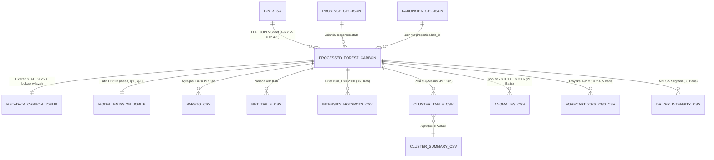

# 04. Skema Data, Rasionalisasi Fitur, & Kontrak Artefak

Dokumen ini merupakan referensi teknis lengkap bagi seluruh data masukan, fitur hasil rekayasa, berkas serialisasi model (`.joblib`), batas spasial (`.geojson`), dan seluruh keluaran `.csv`. Setiap komponen dilengkapi penjelasan **tujuan pembuatan**, **alasan pemilihan fitur/pemisahan berkas**, serta **definisi kolom** sehingga pembaca dapat memahami struktur data sepenuhnya tanpa perlu membaca kode [`carbonara_notebook.ipynb`](../carbonara_notebook.ipynb).

---

## Daftar Isi

- [1. Peta Relasi Entitas dan Aliran Artefak](#1-peta-relasi-entitas-dan-aliran-artefak)
- [2. Berkas Sumber Mentah IDN xlsx](#2-berkas-sumber-mentah-idn-xlsx)
- [3. Artefak Serialisasi Model dan State](#3-artefak-serialisasi-model-dan-state)
  - [3.1 model_emission.joblib](#31-model_emissionjoblib)
  - [3.2 metadata_carbon.joblib](#32-metadata_carbonjoblib)
- [4. Data Spasial Geografis GeoJSON](#4-data-spasial-geografis-geojson)
- [5. Penjelasan Lengkap processed_forest_carbon csv dan Rasionalisasi Fitur](#5-penjelasan-lengkap-processed_forest_carbon-csv-dan-rasionalisasi-fitur)
  - [5.1 Kelompok Identitas dan Target](#51-kelompok-identitas-dan-target)
  - [5.2 Kelompok Baseline Wilayah dan Neraca Statis GFW](#52-kelompok-baseline-wilayah-dan-neraca-statis-gfw)
  - [5.3 Kelompok Kehilangan Tutupan dan Pemicu Mentah](#53-kelompok-kehilangan-tutupan-dan-pemicu-mentah)
  - [5.4 Kelompok Fitur Hasil Rekayasa COLD](#54-kelompok-fitur-hasil-rekayasa-cold)
  - [5.5 Kelompok Fitur Rekam Jejak Wilayah WARM](#55-kelompok-fitur-rekam-jejak-wilayah-warm)
- [6. Penjelasan Mendalam Delapan Berkas CSV Analitik](#6-penjelasan-mendalam-delapan-berkas-csv-analitik)
  - [6.1 pareto.csv](#61-paretocsv)
  - [6.2 driver_intensity.csv](#62-driver_intensitycsv)
  - [6.3 net_table.csv](#63-net_tablecsv)
  - [6.4 intensity_hotspots.csv](#64-intensity_hotspotscsv)
  - [6.5 cluster_table.csv](#65-cluster_tablecsv)
  - [6.6 cluster_summary.csv](#66-cluster_summarycsv)
  - [6.7 anomalies.csv](#67-anomaliescsv)
  - [6.8 forecast_2026_2030.csv](#68-forecast_2026_2030csv)
- [7. Keluaran Sekunder Notebook di Luar Pelacakan Git](#7-keluaran-sekunder-notebook-di-luar-pelacakan-git)

---

## 1. Peta Relasi Entitas dan Aliran Artefak

Seluruh tabel tabulasi tingkat wilayah memakai **kunci komposit `["subnational1", "subnational2"]`** untuk membedakan nama kabupaten/kota yang kembar lintas provinsi (`497` entitas pasangan provinsi–kabupaten dibandingkan `496` nama `subnational2` unik).

---

## 2. Berkas Sumber Mentah IDN xlsx

- **Lokasi Berkas:** `data/raw/IDN.xlsx`
- **Sumber:** Global Forest Watch (GFW) Subnational 2 Indonesia, rilis `v20260427`.
- **Ambang Kanopi:** `threshold = 30%` (`umd_tree_cover_density_2000__threshold == 30` pada sheet karbon).
- **Rentang Temporal:** `2001–2025` (25 tahun).

| Sheet Sumber | Kolom yang Diekstrak | Transformasi & Alasan |
|---|---|---|
| `Subnational 2 tree cover loss` | `subnational1`, `subnational2`, `area_ha`, `extent_2000_ha`, `extent_2010_ha`, `tc_loss_ha_2001..2025` | Diubah dari format lebar (*wide*, satu kolom per tahun) menjadi format panjang (*long*, satu baris per kabupaten-tahun) agar selaras dengan struktur panel. |
| `Subnational 2 primary loss` | `subnational1`, `subnational2`, `tc_loss_ha_2002..2025` | GFW baru mencatat kehilangan hutan primer mulai tahun `2002`. Tahun `2001` dipertahankan sebagai `NaN` agar tidak keliru diartikan sebagai nol kehilangan. |
| `Subnational 2 drivers` | `subnational1`, `subnational2`, `year`, `driver`, `tc_loss_ha` | Di-*pivot* menjadi 7 kolom pemicu. Hanya memuat `494` kabupaten; `3` wilayah tanpa catatan diisi `0.0` setelah `LEFT JOIN`. |
| `Subnational 2 primary drivers` | `Permanent agriculture`, `Wildfire`, `Logging` | Di-*pivot* menjadi `primary_agri_ha`, `primary_fire_ha`, `primary_logging_ha` untuk keperluan audit sebaran pemicu pada hutan primer. |
| `Subnational 2 carbon data` | Stok & densitas 2000, `gross_emissions_2001..2025`, `removals_avg`, `net_flux_avg`, `gross_avg` | Dijadikan tabel induk (`497` kabupaten) agar tidak ada wilayah yang hilang saat digabung. |

---

## 3. Artefak Serialisasi Model dan State

### 3.1 `model_emission.joblib`
- **Lokasi Berkas:** `artifacts/models/model_emission.joblib`
- **Mengapa disimpan terpisah sebagai `.joblib`?** Pelatihan tiga estimator `HistGradientBoostingRegressor` (`max_iter=300`) beserta seluruh validasinya membutuhkan waktu dan ketergantungan pustaka pelatihan. Dengan menyimpannya dalam bentuk biner terkompresi (`compress=3`), [`app.py`](../app.py) langsung memuat model terlatih ke memori melalui `@st.cache_resource` dalam hitungan milidetik.
- **Isi Struktur (`dict`):**
  - `"mean"` (`HistGradientBoostingRegressor`): Memprediksi nilai tengah $\ln\left(\frac{E+1}{\text{total loss ha}+1}\right)$.
  - `"q10"` (`HistGradientBoostingRegressor(loss="quantile", quantile=0.10)`): Batas bawah optimis (persentil ke-10).
  - `"q90"` (`HistGradientBoostingRegressor(loss="quantile", quantile=0.90)`): Batas atas pesimis (persentil ke-90).

### 3.2 `metadata_carbon.joblib`
- **Lokasi Berkas:** `artifacts/models/metadata_carbon.joblib`
- **Mengapa diperlukan file metadata tersendiri?** Saat pengguna melakukan simulasi skenario masa depan di [`app.py`](../app.py), pengguna hanya memasukkan luas 7 pemicu dan luas hutan primer. Model ML membutuhkan **27 kolom berurutan** termasuk kondisi sisa tutupan hutan akhir tahun `2025` (`remaining_extent_ha`, `hist_intensity`, stok karbon tahun 2000, dll.). File ini menyimpan *snapshot* kondisi akhir tersebut agar antarmuka web tidak perlu menghitung ulang agregat historis tiap kali pengguna menggeser input.

| Key | Tipe | Isi & Fungsi di Aplikasi |
|---|---|---|
| `"feature_names"` | `list[str]` (27 item) | Daftar dan urutan resmi fitur `WARM` yang digunakan fungsi `build_row()` sebelum diprediksi `models[...]`. |
| `"cold_features"` | `list[str]` (25 item) | Daftar fitur `COLD` tanpa riwayat intensitas; disimpan sebagai dokumentasi skema pelatihan *out-of-sample*. |
| `"driver_list"` | `list[str]` (7 item) | Daftar nama resmi 7 kategori pemicu GFW untuk membangun kontrol input UI. |
| `"lookup_wilayah"` | `pd.DataFrame` (497 baris) | Referensi statis per kabupaten (`subnational1`, `subnational2`, `umd_tree_cover_extent_2000__ha`, `gfw_aboveground_carbon_stocks_2000__Mg_C`, `avg_gfw_aboveground_carbon_stocks_2000__Mg_C_ha-1`) untuk mengisi dropdown *sidebar* dan metrik stok awal. |
| `"state"` | `pd.DataFrame` (497 baris) | *Snapshot* kondisi akhir tahun `2025` per kabupaten (`area_ha`, `cum_loss_prior_ha`, `remaining_extent_ha`, `remaining_frac`, `remaining_carbon_Mg_C`, `forest_cover_frac`, `hist_intensity`, dan baseline 2000) yang di-index menjadi `STATE` di `app.py`. |
| `"last_year"` | `int` | `2025`. Menentukan tahun simulasi (`LAST_YEAR + 1 = 2026`), label metrik, dan filter jendela 5 tahun terakhir (`year > LAST_YEAR - 5`). |
| `"target"` | `str` | `"log_intensity"`, penanda formulasi target yang digunakan model. |

---

## 4. Data Spasial Geografis GeoJSON

| Berkas | Jumlah Poligon | Kunci Join | Penjelasan & Penggunaan |
|---|---|---|---|
| `data/geo/indonesia_provinces.geojson` | 34 poligon | `properties.state` | Menyimpan geometri batas provinsi Indonesia (`cartodb_id`, `country`, `id_1`, `slug`, `state`). Pada [`app.py`](../app.py#L556), nama `"Bangka Belitung"` di data CSV dipetakan menjadi `"Bangka-Belitung"` agar cocok dengan `properties.state`. Digunakan untuk peta nasional dan *fallback* peta provinsi/kabupaten. |
| `data/geo/indonesia_kabupaten.geojson` | 507 poligon | `properties.kab_id` | Menyimpan geometri batas kabupaten/kota (koordinat `SRS_ID = 4326`) dengan properti `subnational1`, `subnational2`, `kab_id` (`"<subnational1> - <subnational2>"`), `WADMPR`, dan `WADMKK`. Disaring per `subnational1 == prov` sebelum dirender di tab *Peta & Prioritas*. |

---

## 5. Penjelasan Lengkap processed_forest_carbon csv dan Rasionalisasi Fitur

### Mengapa Berkas Ini Dihasilkan?
Berkas `IDN.xlsx` terdiri dari 5 sheet berformat *wide* dengan penamaan kolom yang berbeda-beda dan memiliki perbedaan cakupan wilayah (497 vs 494 kabupaten). Membaca dan menggabungkan Excel secara langsung saat startup aplikasi web akan lambat dan membutuhkan pustaka `openpyxl`. Oleh karena itu, seluruh proses penggabungan, pembersihan, audit, dan perhitungan fitur dilakukan sekali di notebook lalu diekspor ke `data/processed/processed_forest_carbon.csv` (**12.425 baris = 497 kabupaten × 25 tahun**, **39 kolom**).

Di [`app.py`](../app.py), berkas ini menjadi sumber data utama untuk: *Header Executive Metrics*, *Tren & Pemicu*, *Peta & Prioritas*, garis realisasi historis pada *Proyeksi 2026–2030*, serta perhitungan rata-rata 5 tahun terakhir pada tab *Tools*.

---

### 5.1 Kelompok Identitas dan Target

| Kolom | Tipe / Satuan | Alasan & Peran dalam Sistem |
|---|---|---|
| `subnational1` | `str` | Nama provinsi. Bersama `subnational2` membentuk kunci komposit unik agar kabupaten bernama sama di provinsi berbeda tidak tercampur. |
| `subnational2` | `str` | Nama kabupaten/kota. Unit analisis terkecil di seluruh sistem. |
| `gross_emissions_Mg_CO2e` | `float` ($\text{Mg CO}_2\text{e}$) | **Target utama model (`TARGET`).** Mengukur total pelepasan gas rumah kaca bruto tahunan di kabupaten tersebut pada tahun `year`. |
| `year` | `int` (`2001–2025`) | **Masuk fitur model (`COLD` & `WARM`).** Digunakan sebagai indeks waktu untuk pemisahan uji temporal (`<=2021` vs `2022–2025`) serta menangkap tren pergeseran intensitas emisi antar-dekade (misal perubahan komposisi tutupan dan praktik pembukaan lahan seiring waktu). |

---

### 5.2 Kelompok Baseline Wilayah dan Neraca Statis GFW

| Kolom | Tipe / Satuan | Masuk Fitur? | Alasan & Peran dalam Sistem |
|---|---|---|---|
| `area_ha` | `float` (ha) | **Ya** | Luas administratif total kabupaten. Memberikan konteks skala wilayah kepada model (kehilangan 5.000 ha di kabupaten kecil memiliki tekanan ekologis berbeda dibanding di kabupaten raksasa Kalimantan). |
| `extent_2000_ha` | `float` (ha) | Tidak | Luas tutupan pohon tahun 2000 dari sheet *tree cover loss*. Disimpan sebagai referensi audit; untuk fitur model digunakan kolom resmi dari sheet karbon (`umd_tree_cover_extent_2000__ha`). |
| `extent_2010_ha` | `float` (ha) | Tidak | Luas tutupan pohon tahun 2010 dari sheet *tree cover loss*. Disimpan untuk kelengkapan riwayat profil tutupan lahan. |
| `umd_tree_cover_extent_2000__ha` | `float` (ha) | **Ya** | Baseline resmi luas tutupan pohon berkanopi $\ge 30\%$ pada tahun 2000. Menjadi penyebut untuk menghitung rasio kehilangan tutupan dan sisa hutan. |
| `gfw_aboveground_carbon_stocks_2000__Mg_C` | `float` (Mg C) | **Ya** | Total cadangan karbon biomassa di atas permukaan tanah pada tahun 2000. Merupakan fitur terpenting kedua di model (`permutation importance = 0.0444`) karena merepresentasikan total kapasitas karbon wilayah. |
| `avg_gfw_aboveground_carbon_stocks_2000__Mg_C_ha-1` | `float` ($\text{Mg C/ha}$) | **Ya** | Densitas karbon rata-rata per hektare pada tahun 2000. Membedakan wilayah berhutan lebat (misal Papua $>140\text{ Mg C/ha}$) dari wilayah bervegetasi jarang sebelum terjadinya gangguan. |
| `removals_avg_Mg_CO2_yr` | `float` ($\text{Mg CO}_2\text{/thn}$) | **Tidak** | Rata-rata serapan karbon tahunan GFW (2001–2025). Disimpan untuk referensi neraca, tidak dimasukkan ke fitur model emisi kotor. |
| `net_flux_avg_Mg_CO2e_yr` | `float` ($\text{Mg CO}_2\text{e/thn}$) | **Tidak (Dilarang)** | Rata-rata *net flux* 2001–2025. **Sengaja dikeluarkan dari fitur model** karena dihitung dari emisi rata-rata 25 tahun—memasukkannya akan menyebabkan *data leakage* target masa depan. |
| `gfw_forest_carbon_gross_emissions__Mg_CO2e_yr-1` | `float` ($\text{Mg CO}_2\text{e/thn}$) | **Tidak (Dilarang)** | Rata-rata emisi kotor tahunan 25 tahun dari sheet karbon. **Dilarang masuk fitur model** karena merupakan agregasi langsung dari target sepanjang 2001–2025. |

---

### 5.3 Kelompok Kehilangan Tutupan dan Pemicu Mentah

| Kolom | Tipe / Satuan | Masuk Fitur? | Alasan & Peran dalam Sistem |
|---|---|---|---|
| `tc_loss_ha` | `float` (ha) | Tidak | Total kehilangan tutupan pohon dari sheet *tree cover loss*. Dipakai untuk menghitung `cum_loss_prior_ha` dan audit rasio kecocokan terhadap penjumlahan 7 *drivers* (`0,9983`); untuk fitur input total di model dipakai `total_loss_ha` agar penjumlahan selalu konsisten dengan 7 slider driver di simulator. |
| `Hard commodities`, `Logging`, `Other natural disturbances`, `Permanent agriculture`, `Settlements & Infrastructure`, `Shifting cultivation`, `Wildfire` (7 kolom) | `float` (ha) | **Ya (Semua 7)** | Rincian luas kehilangan per aktivitas. Diperlukan agar model dan simulator *what-if* mengetahui perbedaan profil emisi antara pembukaan sawit, pembalakan, tambang, infrastruktur, dan kebakaran hutan. |
| `primary_loss_ha` | `float` (ha) | **Ya** | Luas kehilangan hutan alam primer (`NaN` pada 2001). Krusial karena pembukaan 1 ha hutan primer melepas hampir 2× lipat emisi dibanding hutan sekunder. |
| `primary_agri_ha`, `primary_fire_ha`, `primary_logging_ha` (3 kolom) | `float` (ha) | Tidak | Rincian hutan primer per 3 pemicu utama dari sheet *primary drivers*. Disimpan di tabel panel untuk keperluan audit/eksplorasi lanjutan, namun tidak dimasukkan ke 27 fitur model agar skema input simulator di `app.py` tetap ringkas (cukup 7 pemicu + total hutan primer). |

---

### 5.4 Kelompok Fitur Hasil Rekayasa COLD

Seluruh fitur berikut dibentuk untuk membantu `HistGradientBoostingRegressor` memahami skala, proporsi, stoikiometri fisika, dan penipisan tutupan hutan dari waktu ke waktu:

| Kolom | Formula | Mengapa Fitur Ini Dibuat? |
|---|---|---|
| `total_loss_ha` | $\sum_{d=1}^{7} \text{driver}_d$ | Penjumlahan eksplisit 7 kategori pemicu. Menjadi skala utama (`L`) pada target log-intensitas serta fitur paling berpengaruh (`importance = 0.3467`) untuk membedakan intensitas kejadian kecil vs pembukaan masif. |
| `agri_loss_ratio` | $\dfrac{\text{Perm. Agri} + \text{Shifting}}{\text{total loss ha} + 10^{-6}}$ | Mengukur dominasi konversi pertanian secara **independen terhadap luas**. Dua kabupaten dengan luas kehilangan berbeda tetapi sama-sama 90% didominasi agrikultur akan dikenali memiliki karakter pemicu serupa. |
| `wildfire_ratio` | $\dfrac{\text{Wildfire}}{\text{total loss ha} + 10^{-6}}$ | Mengukur porsi keterlibatan api. Pada tahun kejadian kebakaran ekstrem (seperti El Niño), rasio ini tinggi dan berasosiasi erat dengan pelepasan karbon gambut ekstra. |
| `loss_extent_ratio` | $\dfrac{\text{total loss ha}}{\text{extent 2000} + 1}$ | Mengukur tingkat keparahan gangguan relatif terhadap total luas hutan awal kabupaten tahun 2000. |
| `potential_co2e` | $\text{total loss ha} \times \text{densitas}_{2000} \times \frac{44}{12}$ | Memberikan **jangkar fisika stoikiometri** dari biomassa di atas tanah. Dengan adanya fitur ini, model dapat langsung membaca selisih antara emisi teoritis kayu permukaan dan emisi aktual (terutama pada wilayah gambut). |
| `cum_loss_prior_ha` | $\sum_{t'=2001}^{t-1} \text{tc loss ha}_{t'}$ | Akumulasi kehilangan tutupan **hanya pada tahun-tahun sebelum tahun $t$** (`cumsum - current`). Pengurangan tahun berjalan wajib dilakukan untuk mencegah kebocoran informasi tahun $t$. |
| `remaining_extent_ha` | $\max(\text{extent 2000} - \text{cum loss prior ha},\; 0)$ | Estimasi luas tutupan pohon yang masih tersisa saat memasuki tahun $t$. Menunjukkan apakah cadangan hutan daerah tersebut masih luas atau sudah hampir habis terdeforestasi. |
| `remaining_frac` | $\dfrac{\text{remaining extent ha}}{\text{extent 2000} + 1}$ | Versi ternormalisasi (`0–1`) dari sisa hutan agar kabupaten kecil dan besar dapat dibandingkan proporsi penyusutan hutannya. |
| `loss_remaining_ratio` | $\dfrac{\text{total loss ha}}{\text{remaining extent ha} + 1}$ | Mengukur tekanan kehilangan tahun $t$ terhadap sisa hutan yang benar-benar masih tersedia di tahun tersebut. |
| `remaining_carbon_Mg_C` | $\text{remaining extent ha} \times \text{densitas}_{2000}$ | Estimasi sisa stok karbon biomassa atas tanah yang masih tersimpan menjelang tahun $t$. |
| `primary_share` | $\dfrac{\text{primary loss ha}}{\text{tc loss ha} + 10^{-6}}$ | Proporsi hutan primer dalam kehilangan tahun tersebut (`NaN` di 2001). Rasio ini memberi sinyal langsung kualitas kepadatan karbon tutupan yang hilang tanpa bergantung pada skala luas. |
| `forest_cover_frac` | $\dfrac{\text{extent 2000}}{\text{area ha} + 1}$ | Fraksi luas kabupaten yang tertutup hutan pada baseline 2000 (membedakan kabupaten berhutan lebat dari wilayah urban/terbuka). |

---

### 5.5 Kelompok Fitur Rekam Jejak Wilayah WARM

| Kolom | Formula | Mengapa Fitur Ini Dibuat? |
|---|---|---|
| `hist_intensity` | $\dfrac{\sum_{t'=2001}^{t-1} E_{t'}}{\left(\sum_{t'=2001}^{t-1} \text{total loss ha}_{t'}\right) + 1}$ *(jika `cum_loss_prior` $> 50\text{ ha}$, else `NaN`)* | **Proksi utama karbon bawah tanah (gambut).** Karena data kedalaman gambut tidak tersedia di `IDN.xlsx`, riwayat berapa ton $\text{CO}_2\text{e}$ yang rata-rata lepas per hektare di masa lalu menjadi sinyal kuat apakah daerah tersebut berdiri di atas tanah gambut atau mineral. Ambang `> 50 ha` mencegah nilai rasio meledak akibat pembagi sangat kecil di tahun-tahun awal, dan perhitungan ketat **sebelum tahun $t$** menjaga agar tidak terjadi *temporal leakage*. |
| `hist_intensity_x_loss` | $\text{hist intensity} \times \text{total loss ha}$ | Suku interaksi (*interaction term*) yang mewakili perkiraan langsung beban emisi berbasis riwayat intensitas daerah dikalikan luas bukaan tahun berjalan. |

---

## 6. Penjelasan Mendalam Delapan Berkas CSV Analitik

Seluruh berkas CSV di bawah ini dihasilkan secara *offline* oleh [`carbonara_notebook.ipynb`](../carbonara_notebook.ipynb) ke direktori `artifacts/data/` dan dimuat ke memori oleh [`app.py`](../app.py). Pemisahan menjadi berkas CSV terpisah bertujuan agar dashboard tidak perlu mengulang optimasi numerik (NNLS), komputasi klasterisasi (K-Means + PCA), maupun *backtesting* multi-horizon setiap kali pengguna membuka halaman web, sekaligus memastikan hasil tetap deterministik (`SEED = 42`).

---

### 6.1 `pareto.csv`

*(Dimensi: 497 baris × 6 kolom)*
- **Mengapa berkas ini dibuat?** Untuk menyajikan kurva konsentrasi emisi nasional (*Pareto 80/20*) dan menghitung secara instan jumlah kabupaten prioritas (`_n80 = 86`) di tab *Peta & Prioritas* level Nasional tanpa mengagregasi ulang 12.425 baris tiap kali slider digeser.
- **Cakupan Baris:** Seluruh 497 kabupaten/kota, diurutkan dari kontributor emisi kumulatif terbesar (Pelalawan) hingga terkecil.

| Kolom | Tipe | Satuan / Rentang | Penjelasan |
|---|---|---|---|
| `subnational1` | `str` | — | Nama provinsi |
| `subnational2` | `str` | — | Nama kabupaten/kota |
| `gross_emissions_Mg_CO2e` | `float` | $\text{Mg CO}_2\text{e}$ | Total akumulasi emisi kotor kabupaten sepanjang `2001–2025` |
| `share` | `float` | `[0..1]` | Porsi kontribusi kabupaten terhadap total emisi nasional `23,59 Gt CO₂e` |
| `cum_share` | `float` | `[0..1]` | Akumulasi berurut `share` dari peringkat 1 ke bawah (`< 0.8` menentukan 86 wilayah prioritas) |
| `rank` | `int` | `1..497` | Peringkat kontributor emisi kumulatif nasional |

---

### 6.2 `driver_intensity.csv`

*(Dimensi: 30 baris × 3 kolom)*
- **Mengapa berkas ini dibuat?** Estimasi intensitas emisi per hektare per pemicu memerlukan penyelesaian sistem persamaan linier terkendala non-negatif (*Non-Negative Least Squares* / `scipy.optimize.nnls`) pada beberapa irisan segmen populasi (keseluruhan, 3 kuantil densitas karbon, dan primer vs non-primer). Hasilnya diekspor agar tersimpan sebagai tabel rujukan yang stabil.
- **Cakupan Baris:** 5 segmen analisis (`All`, `Density low`, `Density mid`, `Density high`, masing-masing 7 *drivers* = 28 baris; ditambah segmen `Primary vs non-primary` 2 baris = **30 baris**).
- **Status di `app.py`:** Dimuat pada startup ke variabel `di` (`app.py` baris 199), namun belum dirender menjadi grafik tersendiri; angka kunci `~1.170` (primer) vs `~629 Mg CO₂e/ha` (non-primer) dikutip langsung pada keterangan analitis di tab *Tren & Pemicu*.

| Kolom | Tipe | Satuan / Nilai | Penjelasan |
|---|---|---|---|
| `segment` | `str` | `All`, `Density low`, `Density mid`, `Density high`, `Primary vs non-primary` | Irisan segmen wilayah yang diestimasi; segmen densitas dibagi melalui `pd.qcut(..., 3)` berdasarkan densitas karbon tahun 2000 |
| `driver` | `str` | Nama 7 pemicu GFW / `Primary forest loss` / `Non-primary loss` | Kategori pemicu kehilangan tutupan pohon atau status hutan |
| `Mg_CO2e_per_ha` | `float` | $\text{Mg CO}_2\text{e/ha}$ ($\ge 0$) | Koefisien estimasi emisi per hektare dari optimasi NNLS |

---

### 6.3 `net_table.csv`

*(Dimensi: 497 baris × 15 kolom)*
- **Mengapa berkas ini dibuat?** Analisis neraca emisi bersih (*Net Flux*) membutuhkan penggabungan tabel statis baseline GFW (emisi kotor rata-rata, serapan rata-rata, dan net flux rata-rata) dengan akumulasi emisi serta luas kehilangan 25 tahun (`cum_E`, `cum_L`), serta klasifikasi status `Net sink` / `Net source`. Menyimpannya sebagai satu tabel ringkas 497 baris mempercepat rendering metrik, bar provinsi/kabupaten, dan plot kuadran log-log di tab *Emisi Bersih & Hotspot*.

| Kolom | Tipe | Satuan | Penjelasan |
|---|---|---|---|
| `subnational1`, `subnational2` | `str` | — | Kunci komposit provinsi dan kabupaten/kota |
| `area_ha` | `float` | ha | Luas wilayah administratif |
| `extent_2000_ha`, `extent_2010_ha` | `float` | ha | Luas tutupan pohon tahun 2000 dan 2010 (sheet *tree cover loss*) |
| `umd_tree_cover_extent_2000__ha` | `float` | ha | Baseline luas tutupan pohon tahun 2000 (sheet *carbon*) |
| `gfw_aboveground_carbon_stocks_2000__Mg_C` | `float` | Mg C | Total stok karbon atas tanah tahun 2000 |
| `avg_gfw_aboveground_carbon_stocks_2000__Mg_C_ha-1` | `float` | Mg C/ha | Densitas karbon atas tanah rata-rata tahun 2000 |
| `removals_avg_Mg_CO2_yr` | `float` | $\text{Mg CO}_2\text{/thn}$ | Rata-rata serapan karbon tahunan GFW (`2001–2025`) |
| `net_flux_avg_Mg_CO2e_yr` | `float` | $\text{Mg CO}_2\text{e/thn}$ | Selisih rata-rata emisi kotor dikurangi serapan (`< 0` penyerap, `> 0` sumber emisi) |
| `gross_avg_Mg_CO2e_yr` | `float` | $\text{Mg CO}_2\text{e/thn}$ | Rata-rata emisi kotor tahunan GFW (`2001–2025`) |
| `net_status` | `str` | `Net sink` / `Net source` | Kategori biner: `Net sink` jika `net_flux_avg_Mg_CO2e_yr < 0`, selainnya `Net source` |
| `cum_E` | `float` | $\text{Mg CO}_2\text{e}$ | Total akumulasi emisi kotor sepanjang 2001–2025 |
| `cum_L` | `float` | ha | Total akumulasi luas kehilangan tutupan sepanjang 2001–2025 |
| `net_per_ha` | `float` | $\text{Mg CO}_2\text{e/(ha·thn)}$ | Normalisasi *net flux* terhadap luas tutupan awal: `net_flux_avg / (extent_2000_ha + 1)` |

---

### 6.4 `intensity_hotspots.csv`

*(Dimensi: 365 baris × 6 kolom)*
- **Mengapa berkas ini dibuat?** Untuk mendeteksi kabupaten dengan indikasi kuat pelepasan karbon bawah tanah (gambut) secara kuantitatif. Hanya kabupaten dengan total kehilangan kumulatif $\ge 2.000\text{ ha}$ (`365` dari `497` kabupaten) yang diikutsertakan agar rasio tidak terdistorsi oleh kabupaten dengan luas kehilangan sangat kecil, lalu diurutkan dari rasio tertinggi ke terendah untuk ditampilkan langsung di tab *Emisi Bersih & Hotspot*.

| Kolom | Tipe | Satuan | Penjelasan |
|---|---|---|---|
| `subnational1`, `subnational2` | `str` | — | Kunci komposit wilayah |
| `cum_L` | `float` | ha | Total luas kehilangan tutupan 2001–2025 (semua baris bernilai $\ge 2.000\text{ ha}$) |
| `Mg_CO2e_per_ha_lost` | `float` | $\text{Mg CO}_2\text{e/ha}$ | Intensitas emisi aktual rata-rata: `cum_E / cum_L` |
| `density_aboveground` | `float` | Mg C/ha | Densitas biomassa atas tanah awal tahun 2000 |
| `intensity_vs_aboveground_expectation` | `float` | Rasio (`× lipat`) | Perbandingan `Mg_CO2e_per_ha_lost / (density_aboveground * 44 / 12 + 1)`. Nilai `> 1.0` menandakan emisi riil melebihi potensi stok pohon permukaan |

---

### 6.5 `cluster_table.csv`

*(Dimensi: 497 baris × 22 kolom)*
- **Mengapa berkas ini dibuat?** Algoritma `StandardScaler`, pencarian jumlah klaster optimal `KMeans` (`K=3..7`), serta reduksi dimensi `PCA(2)` dijalankan sekali di notebook agar koordinat `pc1`/`pc2` dan nomor/label klaster setiap kabupaten konsisten dan tidak berubah-ubah saat dashboard dibuka di tab *Tipologi Wilayah*.

| Kelompok Kolom | Nama Kolom | Tipe / Rentang | Penjelasan |
|---|---|---|---|
| **Identitas** | `subnational1`, `subnational2` | `str` | Kunci komposit provinsi dan kabupaten/kota |
| **Proporsi Pemicu (7 kolom)** | `share_Hard commodities`, `share_Logging`, `share_Other natural disturbances`, `share_Permanent agriculture`, `share_Settlements & Infrastructure`, `share_Shifting cultivation`, `share_Wildfire` | `float` `[0..1]` | Porsi masing-masing pemicu terhadap total luas kehilangan tutupan 2001–2025 di kabupaten tersebut |
| **Profil Emisi & Biofisik (9 kolom)** | `log_total_emission` | `float` | $\ln(1 + \text{total emisi 25 tahun})$ |
| | `log_mean_loss` | `float` | $\ln(1 + \text{rata-rata kehilangan tahunan})$ |
| | `density` | `float` (Mg C/ha) | Kepadatan karbon awal tahun 2000 |
| | `loss_extent_ratio` | `float` | Rata-rata tahunan rasio kehilangan terhadap tutupan 2000 |
| | `emission_per_ha` | `float` ($\text{Mg CO}_2\text{e/ha}$) | Intensitas emisi kumulatif: `total_emisi / (total_loss + 1)` |
| | `primary_share` | `float` `[0..1]` | Rata-rata porsi kehilangan hutan primer (2002–2025) |
| | `net_flux_per_ha` | `float` | `net_flux_avg / (extent_2000_ha + 1)` di-*clip* pada `[-100, 100]` untuk menstabilkan klasterisasi |
| | `net_source` | `float` (`0.0` / `1.0`) | Indikator biner status `Net source` (`1.0`) vs `Net sink` (`0.0`) |
| | `trend_rel` | `float` `[-0.3..0.3]` | Kemiringan (*slope*) tren linier emisi tahunan dibagi rata-rata emisi kabupaten, di-*clip* pada `[-0.3, 0.3]` |
| **Hasil Klaster & Proyeksi (4 kolom)** | `cluster` | `int` (`0..4`) | ID numerik klaster hasil `KMeans(K=5)` |
| | `pc1`, `pc2` | `float` | Koordinat dua komponen utama dari `PCA(2)` untuk plot sebar 2D |
| | `cluster_label` | `str` | Label deskriptif klaster (misal `C2: Agrikultur/Sawit (emisi tinggi)`) |

---

### 6.6 `cluster_summary.csv`

*(Dimensi: 5 baris × 16 kolom)*
- **Mengapa berkas ini dibuat?** Menyediakan profil statistik agregat untuk masing-masing dari 5 klaster hasil `cluster_table.csv` agar *heatmap* komposisi pemicu dan tabel ringkas karakteristik tipologi di tab *Tipologi Wilayah* dapat dirender langsung tanpa mengagregasi ulang setiap kali *sidebar* berubah.

| Kolom | Tipe | Penjelasan |
|---|---|---|
| `cluster` | `int` (`0..4`) | ID numerik klaster |
| `n` | `int` | Jumlah kabupaten anggota klaster (`209, 142, 47, 28, 71`) |
| `density` | `float` (Mg C/ha) | Rata-rata kepadatan biomassa anggota klaster |
| `mean_total_emission` | `float` ($\text{Mg CO}_2\text{e}$) | Rata-rata total emisi kumulatif anggota klaster (`expm1(log_total_emission).mean()`) |
| `emission_per_ha` | `float` ($\text{Mg CO}_2\text{e/ha}$) | Rata-rata intensitas emisi per hektare anggota klaster |
| `trend` | `float` | Rata-rata `trend_rel` anggota klaster |
| `primary_share` | `float` `[0..1]` | Rata-rata porsi kehilangan hutan primer |
| `net_source_share` | `float` `[0..1]` | Proporsi anggota klaster yang berstatus `Net source` |
| `share_<driver>` *(7 kolom)* | `float` `[0..1]` | Rata-rata porsi 7 pemicu (dipakai untuk *heatmap* di `app.py`) |
| `label` | `str` | Nama lengkap klaster (yang dipetakan ulang di `app.py` via `CLUSTER_MAP`) |

---

### 6.7 `anomalies.csv`

*(Dimensi: 20 baris × 8 kolom)*
- **Mengapa berkas ini dibuat?** Menyimpan daftar kejadian lonjakan emisi ekstrem (`robust_z > 3.0` dan `gross_emissions_Mg_CO2e > 300.000`) yang sudah disaring dan diklasifikasikan penyebab utamanya untuk dirender di *bubble timeline*, *donut chart*, dan tabel pada tab *Deteksi Anomali* (level Nasional).

| Kolom | Tipe | Satuan | Penjelasan |
|---|---|---|---|
| `subnational1`, `subnational2` | `str` | — | Kunci komposit wilayah terjadinya anomali |
| `year` | `int` | Tahun | Tahun terjadinya lonjakan emisi ekstrem |
| `gross_emissions_Mg_CO2e` | `float` | $\text{Mg CO}_2\text{e}$ | Emisi kotor pada tahun kejadian |
| `total_loss_ha` | `float` | ha | Luas tutupan hilang pada tahun kejadian (menentukan ukuran gelembung di plot) |
| `robust_z` | `float` | Skor-Z | Nilai *Robust Z-Score* berbasis MAD terhadap baseline historis kabupaten tersebut (`> 3.0`) |
| `wildfire_share` | `float` `[0..1]` | Rasio | Porsi luas `Wildfire` terhadap `total_loss_ha` pada tahun kejadian |
| `likely_cause` | `str` | `Kebakaran` / `Agrikultur/Sawit` / `Pembalakan` | Penyebab dominan: `"Kebakaran"` jika `wildfire_share > 0.4`, selainnya driver dengan luas terbesar pada tahun itu |

---

### 6.8 `forecast_2026_2030.csv`

*(Dimensi: 2.485 baris × 7 kolom)*
- **Mengapa berkas ini dibuat?** Proses proyeksi melatih 5 model `HistGB-lag` independen ($h=1..5$) sekaligus menjalankan *rolling-origin backtesting* di 4 tahun asal (`2012, 2015, 2018, 2020`) untuk memilih metode dengan MAE terendah per horizon dan mengestimasi pita ketidakpastian empiris `P10–P90`. Komputasi tersebut terlalu berat jika dijalankan di web, sehingga hasilnya diprekomputasi untuk `497 kabupaten × 5 tahun = 2.485 baris` guna ditampilkan secara instan di tab *Proyeksi 2026–2030*.

| Kolom | Tipe | Satuan / Nilai | Penjelasan |
|---|---|---|---|
| `subnational1`, `subnational2` | `str` | — | Kunci komposit wilayah |
| `year` | `int` | `2026..2030` | Tahun horizon proyeksi (`LAST_YEAR + h` untuk $h = 1..5$) |
| `forecast_Mg_CO2e` | `float` | $\text{Mg CO}_2\text{e}$ | Proyeksi titik emisi kotor tahunan oleh metode pemenang horizon |
| `p10` | `float` | $\text{Mg CO}_2\text{e}$ | Batas bawah interval 80% berdasarkan kuantil 10% log-residual *backtest* |
| `p90` | `float` | $\text{Mg CO}_2\text{e}$ | Batas atas interval 80% berdasarkan kuantil 90% log-residual *backtest* |
| `method` | `str` | `HistGB-lag` / `Naive: 3-yr mean` | Metode terpilih per horizon (`HistGB-lag` untuk `2026–2029`; `Naive: 3-yr mean` untuk `2030`) |

---

## 7. Keluaran Sekunder Notebook di Luar Pelacakan Git

Sel verifikasi terakhir di [`carbonara_notebook.ipynb`](../carbonara_notebook.ipynb) memeriksa ketersediaan **19 berkas** keluaran. Sebelas berkas inti disertakan dalam repositori, sedangkan **8 berkas sekunder** berikut tetap dihasilkan secara lokal saat notebook dieksekusi namun dikecualikan dari pelacakan Git melalui [`.gitignore`](../.gitignore) karena merupakan artefak diagnostik eksperimen yang tidak dibaca oleh [`app.py`](../app.py):

- `artifacts/data/kabupaten_static.csv` — Tabel profil statis 497 kabupaten sebagai bahan perantara pembentukan `net_table.csv`.
- `artifacts/data/data_audit.json` — Ringkasan metrik audit penggabungan panel (`497` vs `494` kabupaten, rasio kecocokan `0.9983`, dan agregat nasional).
- `artifacts/data/metrics.json` — Rekaman tabel skor `R2` dan `MAE` dari enam eksperimen perbandingan model.
- `artifacts/data/feature_importance.csv` & `artifacts/images/feature_importance.png` — Skor numerik dan visualisasi *permutation importance* pada set uji `2022–2025`.
- `artifacts/data/shap_driver.csv` & `artifacts/images/shap_driver.png` — Rata-rata nilai `|SHAP|` dan *summary plot* dari model interpretasi terpisah.
- `artifacts/data/forecast_backtest.csv` — Matriks MAE dan $R^2$ hasil *rolling-origin backtesting* per horizon $h=1..5$.
